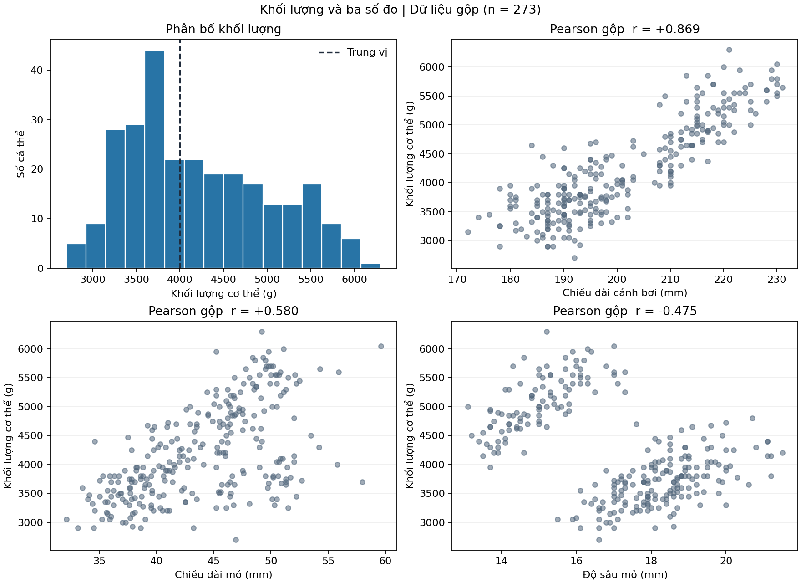
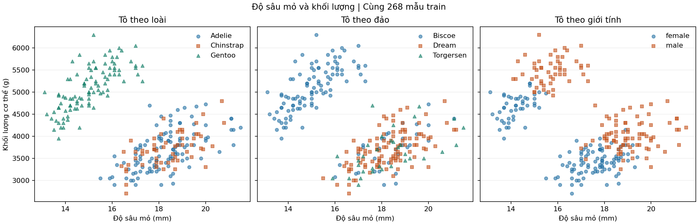
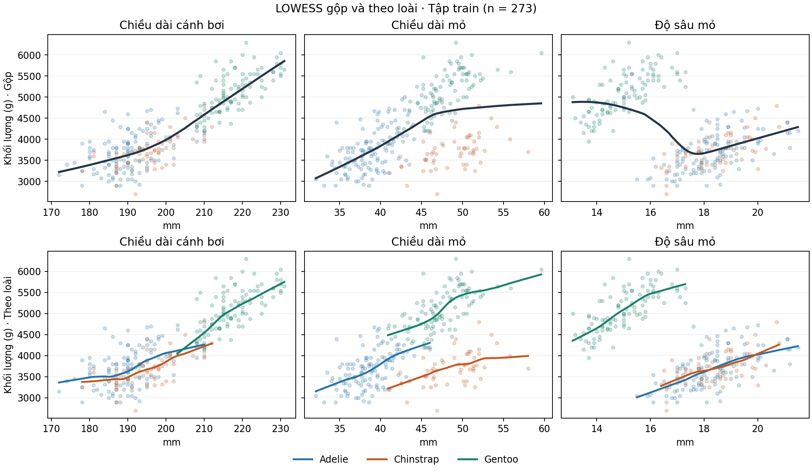

# EDA Palmer Penguins · Lab 01

**Phụ trách** Trần Thiên Phúc (TV4)

**Ngày** 19/11/2026

## Dữ liệu và phạm vi phân tích

CSV gốc có **344 dòng, 8 cột**. Sau khi loại 2 dòng thiếu `body_mass_g`, hàm dùng chung chia 80/20 với seed 42. Các thống kê và biểu đồ dưới đây dùng **273 mẫu train**. 69 mẫu test được dành cho lượt đánh giá sau khi nhóm chốt mô hình. [Notebook, mục 2](../source/lab01.ipynb) · [Nguồn Palmer Penguins](https://allisonhorst.github.io/palmerpenguins/)

Trong tập train, `sex` thiếu ở **5/273 mẫu (1,83%)**. Ba số đo, loài, đảo và năm đầy đủ. Số dòng trùng trên toàn bộ cột là 0. Khối lượng nằm trong khoảng **2.700–6.300 g**, với trung vị **4.000 g**.

## Quan hệ với khối lượng

| Số đo | Pearson gộp với khối lượng |
| --- | ---: |
| Chiều dài cánh bơi | 0,869 |
| Chiều dài mỏ | 0,580 |
| Độ sâu mỏ | −0,475 |

Cell 3 bắt đầu với ba scatterplot một màu. Cánh bơi và chiều dài mỏ đều có tương quan gộp dương. Độ sâu mỏ có tương quan gộp âm và xuất hiện hai vùng điểm: nhiều cá thể nặng có mỏ nông, còn nhiều cá thể nhẹ hơn có mỏ sâu. Quan sát này dẫn đến câu hỏi **ba nhãn loài, đảo và giới tính cho thấy cấu trúc các vùng điểm như thế nào?** Chiều dài mỏ và chiều dài cánh bơi cũng tương quan với nhau (r = 0,651), nên có thể kiểm tra giá trị bổ sung của từng số đo bằng cross-validation trên train.



Khối lượng trung vị của **Gentoo là 5.050 g**, so với **3.700 g** ở cả Adelie và Chinstrap. Khi tách theo loài, nhóm đực có trung vị cao hơn nhóm cái ở cả ba loài trong tập train.

| Loài | Tổng số mẫu | Cái · n, trung vị (g) | Đực · n, trung vị (g) |
| --- | ---: | ---: | ---: |
| Adelie | 116 | 59 · 3.350 | 54 · 3.962,5 |
| Chinstrap | 57 | 31 · 3.525 | 26 · 3.950 |
| Gentoo | 100 | 46 · 4.700 | 52 · 5.500 |

Tổng số mẫu theo loài gồm cả 5 cá thể thiếu `sex`. Biểu đồ giới tính dùng 268 mẫu có thông tin.


## Đề xuất bộ biến chung

| Cột | Đề xuất và lý do |
| --- | --- |
| `flipper_length_mm` | Giữ. Có tương quan dương với khối lượng ở cả ba loài và có thể đo trực tiếp. |
| `bill_length_mm` | Giữ. Có tương quan dương trong từng loài. Đánh giá phần thông tin bổ sung sau khi đã có chiều dài cánh bơi. |
| `bill_depth_mm` | Giữ. Quan hệ dương nhất quán trong từng loài dù dấu tương quan gộp là âm. |
| `species` | Giữ nếu người dùng biết loài khi dự đoán. Tập train có chênh lệch rõ về trung vị giữa Gentoo và hai loài còn lại. |
| `sex` | Giữ nếu có thông tin khi dự đoán. Trung vị khác theo giới tính trong từng loài. Pipeline hiện điền giá trị thiếu bằng mức phổ biến học từ train. |
| `island` | Để ngoài bộ biến ban đầu. Toàn bộ Gentoo trong train ở Biscoe và toàn bộ Chinstrap ở Dream, cho thấy địa điểm và thành phần loài gắn chặt trong mẫu khảo sát. |
| `year` | Để ngoài bộ biến ban đầu. Dữ liệu chỉ có ba năm 2007–2009 và trung vị khối lượng theo năm lần lượt là 3.900, 4.275 và 3.987,5 g. |
| `body_mass_g` | Dùng làm biến đích. |

Bộ đề xuất cho cả bốn mô hình là **ba số đo, loài và giới tính**, trùng với cấu hình mẫu. Khi chốt, nhóm xác nhận khả năng biết loài và giới tính lúc nhập dự đoán. Nếu cần kiểm tra trường hợp chỉ có các số đo, so sánh hai bộ biến trên cùng một thuật toán và cùng các lượt chia train. [Cấu hình `FEATURES`](../source/modeling.py)

## EDA bổ sung · Kiểm định thống kê

Các phân tích dưới đây dùng 273 mẫu train với cách chia hiện có. Phần so sánh giới tính dùng 268 mẫu có `sex` quan sát được. Các khoảng và kiểm định dựa trên giả định lấy mẫu phù hợp và các cá thể độc lập. Diễn giải giới hạn trong liên hệ quan sát được ở tập train.

### Đối chiếu cách phân tầng

Bùi Tiến Lên, *Phân tích dữ liệu* (2023), trình bày Pearson cho hai biến số và bảng chéo cho hai biến định tính ở trang PDF **109**. Ví dụ ở **§8.8**, trang PDF **182–183**, minh họa nghịch lý Simpson bằng cách đối chiếu kết quả gộp và kết quả trong từng nhóm.

**Kiểm tra giả thuyết ở cell 4.** Scatterplot độ sâu mỏ–khối lượng được vẽ lại ba lần, lần lượt tô theo `species`, `island` và `sex`. Các biểu đồ dùng cùng 268 điểm và chung thang trục. Hai bảng chéo giúp đối chiếu thành phần loài khi tô theo đảo và giới tính. [Notebook](../source/lab01.ipynb)

Để so sánh trên cùng cá thể, dùng chung **268 mẫu train** có đủ hai biến đang xét và ba nhãn nhóm. Ba cách phân tầng dưới đây đều dùng Pearson và cùng tập mẫu. Các phân tích khác trong báo cáo dùng lại 273 mẫu train khi đủ cột cho câu hỏi tương ứng.



| Tách theo | Nhóm và số mẫu `n` | Pearson `r` giữa độ sâu mỏ và khối lượng |
| --- | --- | --- |
| Gộp | Toàn bộ mẫu phân tích (268) | −0,475 |
| Loài | Adelie (113), Chinstrap (57), Gentoo (98) | +0,585 · +0,600 · +0,718 |
| Đảo | Biscoe (132), Dream (103), Torgersen (33) | −0,388 · +0,590 · +0,546 |
| Giới tính | Cái (136), đực (132) | −0,739 · −0,764 |

- **Loài.** Hệ số dương trong cả ba nhóm. Bảng trung bình cho thấy Gentoo có mỏ nông hơn (15,0 mm) và nặng hơn (5.101 g) so với Adelie và Chinstrap (mỏ sâu 18,3–18,4 mm, khối lượng trung bình khoảng 3.686–3.708 g). Sự khác biệt giữa các cụm giúp lý giải dấu âm khi gộp.
- **Đảo.** Bảng chéo cho thấy Biscoe gồm 98 Gentoo và 34 Adelie, Dream gồm 57 Chinstrap và 46 Adelie, còn Torgersen chỉ có Adelie. Biscoe vẫn trộn hai cụm loài khác nhau trên cả hai số đo và tương quan ở đó vẫn âm.
- **Giới tính.** Cả nhóm cái lẫn nhóm đực đều có cá thể thuộc cả ba loài. Hai tương quan vẫn âm. Để phân tích riêng chênh lệch khối lượng theo giới tính, mục bên dưới so sánh đực–cái trong từng loài.

Vì vậy, **ưu tiên phân tầng theo loài cho câu hỏi về đảo dấu**. Đây là đối chiếu mô tả trên tập train. Hồi quy điều chỉnh theo loài và kiểm định tương tác độ sâu mỏ × loài ở mục sau định lượng thêm kết quả. Bảng Pearson, trung bình nhóm và hai bảng chéo được tính trong cell **Đối chiếu ba cách phân tầng**, ngay sau scatterplot. [Notebook](../source/lab01.ipynb)

### Tương quan, độ bất định và nghịch lý Simpson

Cell `In [5]` trình bày mục C của issue #10. [Notebook](../source/lab01.ipynb)

Kiểm định Pearson hai phía dùng **9.999 lượt hoán vị** để đánh giá giả thuyết độc lập giữa số đo và khối lượng trong phạm vi đang xét. CI 95% percentile dùng **2.000 lượt bootstrap theo cặp số đo–khối lượng**, seed 42. Cả 12 phép tính đều cho p = 0,0002, mức thấp nhất với cấu hình hoán vị hai phía này. Bảng dùng CI riêng cho từng hệ số. [SciPy Pearson](https://docs.scipy.org/doc/scipy/reference/generated/scipy.stats.pearsonr.html)

| Phạm vi | n | Cánh bơi r [CI 95%] | Chiều dài mỏ r [CI 95%] | Độ sâu mỏ r [CI 95%] |
| --- | ---: | --- | --- | --- |
| Gộp | 273 | 0,869 [0,844; 0,894] | 0,580 [0,499; 0,657] | −0,475 [−0,540; −0,411] |
| Adelie | 116 | 0,419 [0,276; 0,544] | 0,516 [0,389; 0,640] | 0,590 [0,477; 0,688] |
| Chinstrap | 57 | 0,631 [0,477; 0,760] | 0,498 [0,318; 0,652] | 0,600 [0,397; 0,746] |
| Gentoo | 100 | 0,693 [0,586; 0,782] | 0,657 [0,563; 0,736] | 0,714 [0,617; 0,797] |

Đối chiếu Spearman vì đường gộp có đoạn cong và dữ liệu có các điểm biên theo loài. Với độ sâu mỏ, Spearman ρ lần lượt là −0,435 khi gộp và +0,615, +0,564, +0,751 trong Adelie, Chinstrap, Gentoo. Gentoo có độ sâu mỏ trung bình **15,0 mm** và khối lượng trung bình **5.094,5 g**. Hai loài còn lại có độ sâu mỏ trung bình **18,3–18,4 mm** và khối lượng khoảng **3.689–3.708 g**. Chênh lệch trung bình giữa các loài phù hợp với hiện tượng đảo dấu trong mẫu.

| Hồi quy phụ | Hệ số độ sâu mỏ (g/mm) | CI 95% HC3 (g/mm) | p HC3 |
| --- | ---: | --- | ---: |
| Gộp | −197,5 | [−233,5; −161,5] | 7,53 × 10⁻²³ |
| Điều chỉnh theo loài | +253,4 | [217,9; 289,0] | 6,61 × 10⁻³⁴ |
| Adelie | +216,7 | [170,6; 262,9] | 1,16 × 10⁻¹⁵ |
| Chinstrap | +201,4 | [115,1; 287,7] | 1,94 × 10⁻⁵ |
| Gentoo | +353,0 | [283,0; 422,9] | 1,12 × 10⁻¹⁶ |

Hai mô hình gộp dùng `body_mass_g ~ bill_depth_mm` và `body_mass_g ~ bill_depth_mm + C(species)`. Kiểm định chung cho tương tác `bill_depth_mm × species` xét H₀ rằng ba độ dốc bằng nhau, cho **F(2, 267) = 5,922, p = 0,00305** với HC3. Vì vậy, +253,4 g/mm là ước lượng tóm tắt khi dùng một độ dốc chung. Bảng theo loài cho thấy độ lớn của liên hệ khác nhau. [ISLP, biến định tính và tương tác](https://islp.readthedocs.io/en/stable/labs/Ch3-linreg-lab.html#interaction-terms)

### Khác biệt khối lượng theo loài và giới tính

Cell `In [6]` trình bày mục D của issue #10 theo thứ tự: mô tả bằng boxplot, Welch ANOVA theo loài, so sánh từng cặp, rồi kiểm định chênh lệch đực–cái trong từng loài và tương tác loài × giới tính. [Notebook](../source/lab01.ipynb)

SD khối lượng theo loài lần lượt là **448,3 g** (Adelie), **385,3 g** (Chinstrap), **500,9 g** (Gentoo). Welch ANOVA xét H₀ rằng trung bình của ba loài bằng nhau. Kết quả **F(2, 155,73) = 274,07, p = 9,74 × 10⁻⁵²**. Hai họ so sánh đã đặt ra là ba cặp loài và ba so sánh đực–cái trong cùng loài. Mỗi cặp dùng Welch t-test với giả thuyết hai trung bình bằng nhau, báo chênh lệch theo gram và CI 95% riêng lẻ. Holm được áp dụng cho p-value trong từng họ. [Welch ANOVA](https://www.statsmodels.org/v0.14.6/generated/statsmodels.stats.oneway.anova_oneway.html) · [Welch t-test](https://docs.scipy.org/doc/scipy/reference/generated/scipy.stats.ttest_ind.html) · [ISLP, hiệu chỉnh Holm](https://islp.readthedocs.io/en/main/labs/Ch13-multiple-lab.html#family-wise-error-rate)

| So sánh | n₁ / n₂ | Chênh lệch (g) | CI 95% (g) | p Holm |
| --- | --- | ---: | --- | ---: |
| Chinstrap − Adelie | 57 / 116 | +18,7 | [−111,6; 149,0] | 0,777 |
| Gentoo − Adelie | 100 / 116 | +1.405,3 | [1.276,8; 1.533,7] | 1,06 × 10⁻⁵³ |
| Gentoo − Chinstrap | 100 / 57 | +1.386,6 | [1.245,2; 1.528,0] | 2,22 × 10⁻⁴¹ |
| Adelie, đực − cái | 54 / 59 | +690,8 | [581,6; 800,1] | 5,47 × 10⁻²² |
| Chinstrap, đực − cái | 26 / 31 | +416,9 | [239,5; 594,2] | 2,00 × 10⁻⁵ |
| Gentoo, đực − cái | 52 / 46 | +811,6 | [692,1; 931,0] | 2,45 × 10⁻²³ |

Mô hình `body_mass_g ~ C(species) * C(sex)` xét đồng thời loài và giới tính. Kiểm định chung H₀ rằng chênh lệch đực–cái bằng nhau giữa ba loài cho **F(2, 262) = 6,617, p = 0,00157** với HC3. So với Adelie, chênh lệch đực–cái ở Chinstrap nhỏ hơn khoảng **274,0 g**, CI 95% **[−482,0; −65,9] g**, p Holm = 0,0201. Ước lượng tương ứng cho Gentoo là **+120,7 g** với CI **[−41,5; 282,9] g**, p Holm = 0,144. Notebook lưu bảng đầy đủ gồm trung bình, SD, trung vị, IQR, thống kê và bậc tự do từng so sánh.

### LOWESS, điểm bất thường và dạng mô hình



LOWESS dùng `frac=0.65` và ba lượt tái trọng số. Đường gộp của độ sâu mỏ đi xuống ở vùng chuyển tiếp giữa các loài rồi tăng ở nhóm mỏ sâu. Tách theo loài cho xu hướng tăng nhất quán. Đường chiều dài mỏ gộp phẳng dần ở đầu trên. Các đường mô tả hình dạng trên mẫu, nhất là vùng biên có ít điểm. [Statsmodels LOWESS](https://www.statsmodels.org/v0.14.6/generated/statsmodels.nonparametric.smoothers_lowess.lowess.html)

Khối lượng gộp có SD **814,2 g**, IQR **1.300 g**, skewness **0,466**. Quy tắc 1,5 × IQR cho 0 điểm gắn cờ ở cả bốn biến số khi gộp, và **13 cờ theo loài**. Trong số đó có 6 cờ độ sâu mỏ Adelie và 1 cờ khối lượng Chinstrap ở **4.800 g** (chỉ số CSV 313, bắt đầu từ 0). Giữ các quan sát để đối chiếu dữ liệu gốc và dùng cho phân tích độ nhạy. Trong ba số đo, cánh bơi và chiều dài mỏ có r = **0,651**, cánh bơi và độ sâu mỏ có r = **−0,573**, hai số đo mỏ có r = **−0,226**.

| Mô hình | Câu hỏi EDA gợi ý |
| --- | --- |
| OLS | Dùng làm mốc dễ diễn giải. Kiểm định tương tác độ sâu mỏ × loài cho thấy độ dốc chung là một cách tóm tắt. |
| Ridge | Kiểm tra độ ổn định của hệ số với các số đo có tương quan và vai trò của co hệ số. |
| Spline | Kiểm tra qua CV xem các đoạn cong quan sát được có giúp giảm sai số, nhất là khi đường gộp bị chi phối một phần bởi thành phần loài. |
| Huber | Dùng các điểm gắn cờ để đối chiếu thêm với phần dư và phân tích độ nhạy trên train. Kết quả CV và test sẽ cho biết tác dụng đối với dự đoán. |

### Kiểm tra bộ năm biến bằng cross-validation

Dùng OLS và pipeline chung, **5 fold xáo trộn với seed 42**. Mỗi cấu hình dùng chính các fold đó và fit lại tiền xử lý trong từng fold. ΔMAE là MAE trung bình trừ MAE của bộ đủ năm biến. SD mô tả độ phân tán giữa các fold. Notebook có cả MAE, MSE, RMSE và R², mỗi chỉ số kèm trung bình và SD. [ISLP, Cross-Validation](https://islp.readthedocs.io/en/main/labs/Ch05-resample-lab.html#cross-validation)

| Bộ biến | MAE TB ± SD (g) | ΔMAE (g) |
| --- | ---: | ---: |
| Đủ năm biến | 225,59 ± 17,19 | 0,00 |
| Chỉ ba số đo | 321,81 ± 11,30 | +96,22 |
| Bỏ chiều dài cánh bơi | 233,90 ± 20,70 | +8,32 |
| Bỏ chiều dài mỏ | 228,17 ± 16,11 | +2,58 |
| Bỏ độ sâu mỏ | 233,39 ± 12,76 | +7,81 |
| Bỏ loài | 284,03 ± 8,51 | +58,44 |
| Bỏ giới tính | 251,93 ± 15,97 | +26,34 |

**Đề xuất giữ năm biến chung.** Trong lượt CV này, bỏ từng cột đều làm MAE trung bình tăng. Loài và giới tính đóng góp rõ nhất. Độ sâu mỏ có ích khi đã có thông tin loài, phù hợp với kết quả điều chỉnh theo loài. Chênh lệch khi bỏ chiều dài mỏ nhỏ so với độ phân tán giữa các fold, nên giữ kết luận ở mức bằng chứng thăm dò. Giữ `island` và `year` ngoài bộ hiện tại theo lý do ở EDA tuần 1. Bộ năm biến phù hợp với tình huống dự đoán có sẵn loài và giới tính.

### Tái tạo kết quả

Chạy các cell đến hết phần EDA (mục C, D, E) trong mục 2 của notebook hoặc chạy từ thư mục gốc sau khi cài `requirements.txt`.

```powershell
python -m source.eda_statistics --figure report/figures/eda-lowess.png
```

Tham khảo Bùi Tiến Lên, *Phân tích dữ liệu* (2023), §5.5 về khoảng tin cậy, chương 6 về kiểm định, §8.6 và §8.8 về biến định tính và nghịch lý Simpson, §10.1 về ANOVA. [Notebook](../source/lab01.ipynb) · [Mã EDA thống kê](../source/eda_statistics.py)
