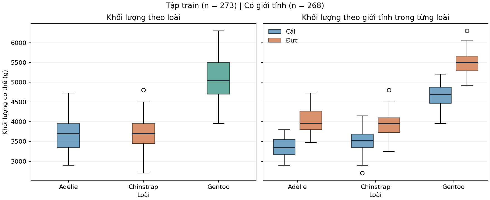

# EDA Palmer Penguins · Lab 01

**Phụ trách** Trần Thiên Phúc (TV4)

**Ngày** 19/11/2026

## Dữ liệu và phạm vi phân tích

CSV gốc có **344 dòng, 8 cột**. Sau khi loại 2 dòng thiếu `body_mass_g`, hàm dùng chung chia 80/20 với seed 42. Các thống kê và biểu đồ dưới đây dùng **273 mẫu train**. 69 mẫu test được dành cho lượt đánh giá sau khi nhóm chốt mô hình. [Notebook, mục 2](../source/lab01.ipynb) · [Nguồn Palmer Penguins](https://allisonhorst.github.io/palmerpenguins/)

Trong tập train, `sex` thiếu ở **5/273 mẫu (1,83%)**. Ba số đo, loài, đảo và năm đầy đủ. Số dòng trùng trên toàn bộ cột là 0. Khối lượng nằm trong khoảng **2.700–6.300 g**, với trung vị **4.000 g**.

## Quan hệ với khối lượng

| Số đo | Pearson gộp | Adelie | Chinstrap | Gentoo |
| --- | ---: | ---: | ---: | ---: |
| Chiều dài cánh bơi | 0,869 | 0,419 | 0,631 | 0,693 |
| Chiều dài mỏ | 0,580 | 0,516 | 0,498 | 0,657 |
| Độ sâu mỏ | −0,475 | 0,590 | 0,600 | 0,714 |

Chiều dài cánh bơi có tương quan gộp cao nhất. Độ sâu mỏ đổi từ tương quan âm khi gộp dữ liệu sang dương trong từng loài. Vì vậy, khi chọn biến nên đọc cả kết quả gộp lẫn kết quả theo loài. Chiều dài mỏ và chiều dài cánh bơi cũng tương quan với nhau (r = 0,651), nên có thể kiểm tra giá trị bổ sung của từng số đo bằng cross-validation trên train.

Khối lượng trung vị của **Gentoo là 5.050 g**, so với **3.700 g** ở cả Adelie và Chinstrap. Khi tách theo loài, nhóm đực có trung vị cao hơn nhóm cái ở cả ba loài trong tập train.

| Loài | Tổng số mẫu | Cái · n, trung vị (g) | Đực · n, trung vị (g) |
| --- | ---: | ---: | ---: |
| Adelie | 116 | 59 · 3.350 | 54 · 3.962,5 |
| Chinstrap | 57 | 31 · 3.525 | 26 · 3.950 |
| Gentoo | 100 | 46 · 4.700 | 52 · 5.500 |

Tổng số mẫu theo loài gồm cả 5 cá thể thiếu `sex`. Biểu đồ giới tính dùng 268 mẫu có thông tin.

## Đề xuất bộ biến chung

| Cột | Đề xuất và lý do |
| --- | --- |
| `flipper_length_mm` | Giữ. Có tương quan dương với khối lượng ở cả ba loài và có thể đo trực tiếp. |
| `bill_length_mm` | Giữ. Có tương quan dương trong từng loài. Đánh giá phần thông tin bổ sung sau khi đã có chiều dài cánh bơi. |
| `bill_depth_mm` | Giữ. Quan hệ dương nhất quán trong từng loài dù dấu tương quan gộp là âm. |
| `species` | Giữ nếu người dùng biết loài khi dự đoán. Tập train có chênh lệch rõ về trung vị giữa Gentoo và hai loài còn lại. |
| `sex` | Giữ nếu có thông tin khi dự đoán. Trung vị khác theo giới tính trong từng loài. Pipeline hiện điền giá trị thiếu bằng mức phổ biến học từ train. |
| `island` | Để ngoài bộ biến ban đầu. Toàn bộ Gentoo trong train ở Biscoe và toàn bộ Chinstrap ở Dream, cho thấy địa điểm và thành phần loài gắn chặt trong mẫu khảo sát. |
| `year` | Để ngoài bộ biến ban đầu. Dữ liệu chỉ có ba năm 2007–2009 và trung vị khối lượng theo năm lần lượt là 3.900, 4.275 và 3.987,5 g. |
| `body_mass_g` | Dùng làm biến đích. |

Bộ đề xuất cho cả bốn mô hình là **ba số đo, loài và giới tính**, trùng với cấu hình mẫu. Khi chốt, nhóm xác nhận khả năng biết loài và giới tính lúc nhập dự đoán. Nếu cần kiểm tra trường hợp chỉ có các số đo, so sánh hai bộ biến trên cùng một thuật toán và cùng các lượt chia train. [Cấu hình `FEATURES`](../source/modeling.py)
