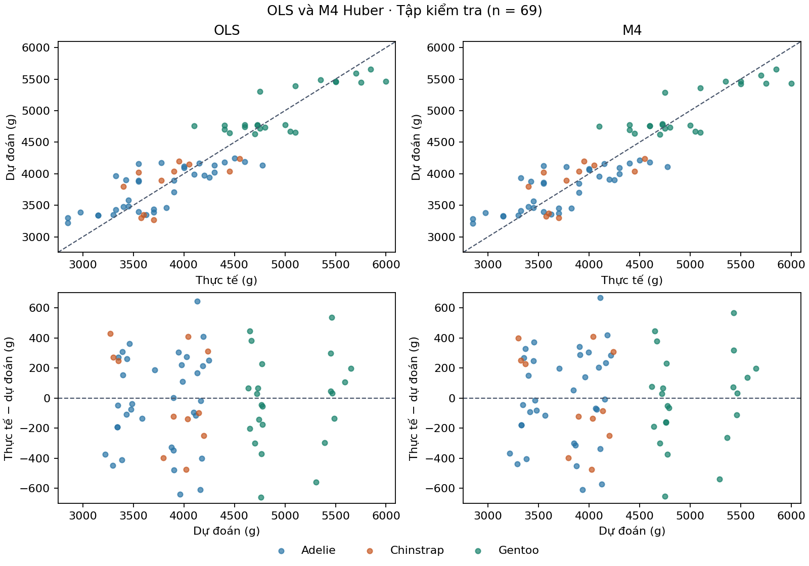

# M4 Huber Regression · Tuần 2

**Phụ trách** Trần Thiên Phúc (TV4)

**Phạm vi** Mục A–B của [issue #10](https://github.com/phuctran33/regression-lab01/issues/10)

## Câu hỏi từ EDA

EDA gắn 13 cờ theo hàng rào 1,5 × IQR trong từng loài. Các cờ này dựa vào phân bố của từng biến. Khi fit mô hình, câu hỏi là liệu khối lượng của một số cá thể có lệch nhiều so với dự đoán từ cả năm đầu vào và làm thay đổi kết quả của OLS hay không. M4 dùng cùng dạng dự đoán tuyến tính và cùng tiền xử lý với OLS để đối chiếu trên hai phương diện **sai số dự đoán** và **độ nhạy khi bỏ các điểm ảnh hưởng**. [EDA](eda-week1.md#lowess-điểm-bất-thường-và-dạng-mô-hình)

## Thiết kế và tinh chỉnh

Dùng 273 mẫu train và 69 mẫu test, chia 80/20 với seed 42 sau khi bỏ hai dòng thiếu khối lượng. Năm đầu vào là chiều dài cánh bơi, chiều dài mỏ, độ sâu mỏ, loài và giới tính. Trong mỗi fold, pipeline điền thiếu và chuẩn hóa số đo, rồi mã hóa one-hot loài và giới tính với Adelie và female làm mức tham chiếu. OLS tối thiểu hóa bình phương phần dư. Huber dùng mất mát bậc hai khi phần dư tuyệt đối nằm dưới ngưỡng `epsilon × scale` và mất mát tuyến tính ở phần đuôi. `alpha` điều chỉnh phạt L2 lên hệ số. [Pipeline chung](../source/modeling.py) · [HuberRegressor](https://scikit-learn.org/1.8/modules/generated/sklearn.linear_model.HuberRegressor.html)

Lưới 48 cấu hình gồm `epsilon` ∈ {1,1 · 1,2 · 1,35 · 1,5 · 1,75 · 2 · 2,5 · 3} và `alpha` ∈ {0 · 10⁻⁵ · 10⁻⁴ · 10⁻³ · 10⁻² · 10⁻¹}. Giá trị 1,35 và 10⁻⁴ là mặc định của thư viện. CV dùng 5 fold xáo trộn, seed 42. Chọn theo MAE trung bình thấp nhất trên train. SD dưới đây là độ lệch chuẩn mẫu giữa năm fold.

| Cấu hình Huber | MAE CV trung bình ± SD (g) |
| --- | ---: |
| **ε = 1,2, α = 0,001** | **225,151 ± 18,341** |
| ε = 1,2, α = 0,0001 | 225,273 ± 18,337 |
| ε = 1,2, α = 0 | 225,305 ± 18,323 |
| Mặc định ε = 1,35, α = 0,0001 | 225,510 ± 16,956 |
| Tốt nhất với α = 0,1 | 260,968 ± 12,570 |

Lưới chọn **ε = 1,2** và **α = 0,001**. Các cấu hình đứng đầu có MAE gần nhau giữa các lượt thử. Mức phạt 0,1 cho sai số cao hơn rõ rệt. Cả 240 lượt fit trong lưới hội tụ. Lượt fit M4 trên toàn train chạy 23 vòng với `max_iter=1000` và `tol=1e-6`. [M4](../source/models/m4.py) · [Lưới và bảng CV](../source/huber_evaluation.py)

| Mô hình | MAE (g) | MSE (g²) | RMSE (g) | R² |
| --- | ---: | ---: | ---: | ---: |
| OLS · CV TB ± SD | 225,586 ± 17,192 | 84.042,9 ± 11.682,6 | 289,288 ± 21,083 | 0,86624 ± 0,02278 |
| M4 · CV TB ± SD | 225,151 ± 18,341 | 83.377,6 ± 12.010,9 | 288,090 ± 21,838 | 0,86749 ± 0,02167 |

## Kết quả trên 69 mẫu test

| Mô hình | MAE (g) | MSE (g²) | RMSE (g) | R² |
| --- | ---: | ---: | ---: | ---: |
| OLS | 256,683 | 94.252,10 | 307,005 | 0,83292 |
| M4 Huber | 255,744 | 92.825,88 | 304,673 | 0,83544 |

Trên mỗi mẫu test, lấy sai số tuyệt đối M4 trừ sai số tuyệt đối OLS. Lấy mẫu lại theo cặp **2.000 lượt**, seed 42, và lấy phân vị 2,5% và 97,5% của chênh lệch MAE trung bình. Kết quả **ΔMAE M4 − OLS = −0,94 g**, CI 95% **[−6,11 đến +4,49 g]**. Khoảng chứa 0. Với cùng dữ liệu train và split này, bằng chứng về cải thiện MAE của M4 còn yếu. Khoảng mô tả bất định từ lấy mẫu lại trên test với hai mô hình đã fit.

Phần dư được tính bằng khối lượng thực tế trừ dự đoán. Trung bình phần dư đổi từ **−17,31 g** ở OLS thành **−4,36 g** ở M4. SD lần lượt là **308,76 g** và **306,87 g**. M4 cho MAE thấp hơn ở Adelie, Chinstrap và nhóm cái, còn ở Gentoo và nhóm đực, OLS có MAE thấp hơn. Chinstrap và nhóm thiếu giới tính có ít mẫu, nên các so sánh nhóm mang tính mô tả.

| Nhóm | n | MAE OLS (g) | MAE M4 (g) | RMSE OLS (g) | RMSE M4 (g) |
| --- | ---: | ---: | ---: | ---: | ---: |
| Adelie | 35 | 262,73 | 261,72 | 312,49 | 309,94 |
| Chinstrap | 11 | 286,24 | 277,96 | 312,32 | 304,85 |
| Gentoo | 23 | 233,35 | 236,03 | 295,82 | 296,39 |
| Cái | 29 | 224,74 | 220,53 | 257,81 | 253,82 |
| Đực | 36 | 278,67 | 280,51 | 331,92 | 330,92 |
| Thiếu giới tính | 4 | 290,36 | 288,16 | 390,43 | 385,47 |



## Quan sát ảnh hưởng và độ nhạy trên train

Chẩn đoán OLS dùng cùng ma trận đầu vào đã tiền xử lý với mô hình dự đoán. Trên 273 mẫu có **1** điểm với |phần dư studentized| > 3, **6** điểm có leverage > 2p/n và **16** điểm có Cook’s distance > 4/n, với p = 7 kể cả hệ số chặn. Các mốc dùng để tìm quan sát cần xem kỹ. Ngưỡng Huber trên toàn train khoảng **148,44 g**. Có **149/273** phần dư nằm trong vùng mất mát tuyến tính, trong đó **6** dòng cũng có cờ IQR. Các dòng này vẫn được dùng khi fit mô hình chính.

| Chỉ số CSV từ 0 | Lý do đối chiếu | Thực tế (g) | OLS (g) | M4 (g) |
| --- | --- | ---: | ---: | ---: |
| 324 | Cook cao nhất | 3.250 | 3.885,62 | 3.898,82 |
| 9 | Cook cao, leverage 0,0549 | 4.250 | 3.700,54 | 3.706,57 |
| 292 | Cook cao và phần dư OLS −794,23 g | 3.300 | 4.094,23 | 4.089,56 |
| 169 | Phần dư studentized lớn nhất về trị tuyệt đối, khoảng 3,31 | 6.300 | 5.380,71 | 5.356,51 |
| 313 | Cờ IQR khối lượng ở Chinstrap | 4.800 | 4.343,37 | 4.337,00 |

Điểm 169 có phần dư lớn hơn dưới M4. Đây là kết quả phù hợp với việc M4 để điểm này kéo đường fit ít hơn. Mức độ ảnh hưởng được kiểm tra trực tiếp bằng cách fit lại bên dưới. Với các hệ số, cùng chuẩn hóa trên toàn train cho phép so sánh theo gram trên một SD của số đo và theo mức tham chiếu của biến phân loại.

| Hệ số | OLS | M4 |
| --- | ---: | ---: |
| Hệ số chặn | 3.643,31 | 3.664,03 |
| Chiều dài cánh bơi | 183,85 | 174,51 |
| Chiều dài mỏ | 89,52 | 119,99 |
| Độ sâu mỏ | 147,70 | 140,69 |
| Chinstrap so với Adelie | −227,57 | −244,44 |
| Gentoo so với Adelie | 1.128,31 | 1.096,56 |
| Đực so với cái | 411,12 | 375,44 |

Giữ siêu tham số cố định. Với mỗi kịch bản, fit lại toàn bộ pipeline của cả hai mô hình trên cùng tập train rút gọn. Đo thay đổi tuyệt đối của dự đoán so với fit đầy đủ trên chính các cá thể train còn lại.

| Kịch bản | n còn lại | Thay đổi TB OLS (g) | Thay đổi TB M4 (g) | Thay đổi max OLS (g) | Thay đổi max M4 (g) |
| --- | ---: | ---: | ---: | ---: | ---: |
| Bỏ điểm 169 có phần dư studentized lớn nhất về trị tuyệt đối | 272 | 5,60 | 2,02 | 16,72 | 5,93 |
| Bỏ 3 điểm Cook lớn nhất, 324, 9 và 292 | 270 | 13,72 | 7,57 | 45,23 | 25,06 |

Trong hai kịch bản, M4 thay đổi dự đoán ít hơn OLS, phù hợp với mục tiêu tăng độ bền trước các điểm được kiểm tra. Phép thử đánh giá **cấu hình Huber đã chọn**, trong đó cả hàm mất mát và phạt L2 đều có thể góp phần. Trên test, cải thiện MAE quan sát được nhỏ và CI vẫn chứa 0. Hai kết quả trả lời hai câu hỏi khác nhau về độ ổn định khi thay đổi train và sai số trên mẫu giữ lại.

## Tái tạo và kiểm thử

Chạy từ thư mục gốc sau khi cài `requirements.txt`.

```powershell
python -m source.models.m4
python -m source.huber_evaluation --figure report/figures/huber-test-comparison.png
python -m unittest discover -s tests -v
```

Notebook dùng phiên bản M4 trên trong bảng đánh giá và bộ chọn dự đoán. [Notebook](../source/lab01.ipynb) · [Mã đánh giá](../source/huber_evaluation.py) · [Kiểm thử M4](../tests/test_huber.py)
