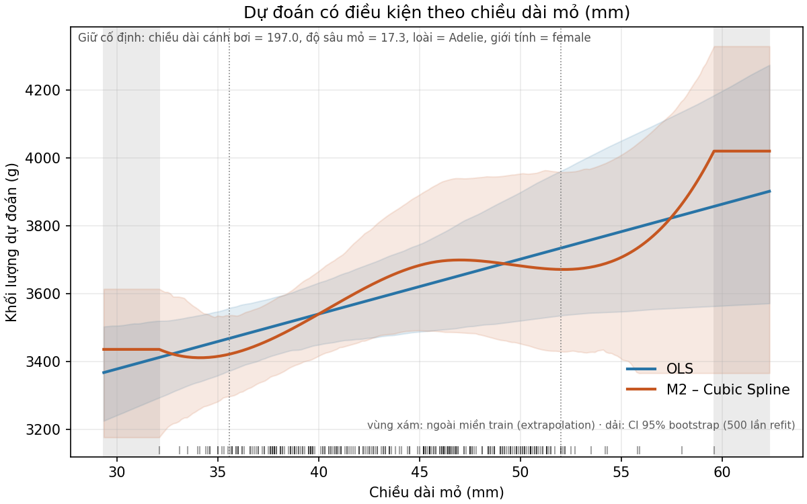
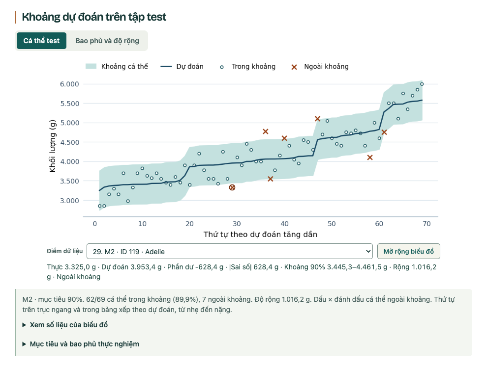

# Khối lượng chim cánh cụt có thể dự đoán chính xác đến đâu?

**Lab 01 · Bản thảo tích hợp của nhóm.** OLS là mốc đối chiếu cho M1 Ridge, M2 spline cơ sở, M3 spline làm mượt và M4 Huber.

## 3.1. Bài toán và dữ liệu

Một ước lượng khối lượng chỉ hữu ích khi người đọc biết sai số có thể lớn đến đâu. Chúng tôi xét hai câu hỏi trên Palmer Penguins. Các số đo và đặc điểm phân loại giúp dự đoán khối lượng một cá thể tốt hơn bao nhiêu so với việc luôn đoán một giá trị? Khi đã có mô hình tuyến tính, mức cải thiện có đủ lớn để cần phạt hệ số hoặc cho đường hồi quy uốn cong?

Đây là hồi quy có giám sát. Đầu ra là `body_mass_g` (g). Đầu vào gồm chiều dài cánh bơi, chiều dài mỏ, độ sâu mỏ (mm), loài và giới tính. CSV có 344 cá thể. Hai dòng thiếu nhãn được loại trước khi chia 273 train và 69 test, seed 42. Dữ liệu quan sát ở quần đảo Palmer cho phép so sánh dự đoán trên cùng cá thể. Việc lấy ngẫu nhiên các dòng cùng nguồn giới hạn khả năng suy rộng sang địa điểm hoặc giai đoạn khác. [Dữ liệu Palmer Penguins](https://allisonhorst.github.io/palmerpenguins/)

EDA ghi nhận quan hệ dương giữa chiều dài cánh bơi và khối lượng trong cả ba loài. Trung vị khối lượng của nhóm Gentoo cao hơn hai loài còn lại. Vì thế mô hình có thể dùng cả kích thước và mức chênh giữa nhóm. Giữ ba số đo cho phép kiểm tra liệu từng số đo còn đóng góp khi đã biết hai số đo kia. EDA thống kê cho thấy tương quan Pearson giữa độ sâu mỏ và khối lượng là −0,475 khi gộp, nhưng dương trong từng loài. Phân nhóm cũng cho thấy khác biệt khối lượng theo loài và giới tính. Năm trường có thể nhập trực tiếp khi demo. [EDA của Phúc](eda-week1.md)

## 3.2. Năm cách mô tả cùng một cá thể

Gọi $y_i$ là khối lượng, $z_{ij}$ là số đo đã chuẩn hóa, $d_i$ là ba biến giả với Adelie và female làm tham chiếu. Pipeline học trung vị, mode, độ lệch chuẩn và mức mã hóa riêng trên phần train của từng lần fit. Hệ số số đo chuẩn hóa có đơn vị g trên một độ lệch chuẩn train. Hiệu ứng loài hoặc giới tính là chênh lệch dự đoán theo gram, giữ nguyên các biến khác.

- **OLS** tối thiểu hóa $\sum_i(y_i-\beta_0-z_i^T\beta-d_i^T\gamma)^2$. Một độ dốc cố định cho mỗi số đo là mốc dễ kiểm tra. Sai dạng hàm hoặc các cột giải thích gần phụ thuộc nhau ảnh hưởng tới việc diễn giải.
- **M1 Ridge** cộng $\alpha(\|\beta\|^2+\|\gamma\|^2)$ vào tổng bình phương sai số. Hệ số chặn được miễn phạt. Chuẩn hóa ba số đo giúp độ lớn penalty bớt phụ thuộc đơn vị. Các biến giả giữ thang 0/1 nên tác động của cùng một penalty còn phụ thuộc độ phổ biến của mức. CV chọn $\alpha=0,1$ trong 0,01 / 0,1 / 1 / 10 / 100. Đổi một ít độ chệch lấy hệ số ít dao động là động cơ của M1.
- **M2 spline cơ sở** thay tích vô hướng trên số đo bằng $\sum_{j,k}b_{jk}B_{jk}(x_j)$. Pipeline điền trung vị rồi học các mốc đều trên miền từng biến, thay bước chuẩn hóa bằng cơ sở B-spline bậc ba. Cấu hình ba mốc cho bốn cột mỗi số đo, tức 12 cột spline và ba biến giả. Bình phương tối thiểu vẫn tuyến tính theo hệ số. Độ dốc tại một số đo phụ thuộc nhiều hàm cơ sở. CV thử 3–6 mốc. Ngoài biên, phần đóng góp của số đo được giữ hằng.
- **M3 spline làm mượt** ước lượng $\beta_0+d_i^T\gamma+\sum_j f_j(z_{ij})$ bằng cách cộng $\lambda\sum_j\int(f_j''(t))^2\,dt$ vào tổng bình phương sai số. Backfitting lần lượt fit từng hàm trên phần dư riêng, gộp số đo trùng với trọng số bằng số lần xuất hiện và đặt trung bình mỗi hàm bằng 0. Với thiết kế và $\lambda$ cố định, bước làm mượt là toán tử tuyến tính theo đáp ứng. Điều kiện biên tự nhiên cho đạo hàm bậc hai bằng 0 ở biên, code nối tiếp tuyến khi ngoại suy. Lưới 0,1 / 1 / 10 / 100 / 300 / 1.000 / 3.000 có 35/35 lượt CV hội tụ. CV chọn 100, fit 273 mẫu dừng sau 88 vòng khi thay đổi lớn nhất còn 0,00954 g.

- **M4 Huber** dùng dạng dự đoán tuyến tính và cùng tiền xử lý với OLS. Mất mát tăng theo bình phương trong vùng phần dư nhỏ và tăng tuyến tính ngoài ngưỡng epsilon nhân với độ phân tán ước lượng. CV trên train chọn epsilon 1,2 và alpha 0,001 từ 48 cấu hình. [Tinh chỉnh và phân tích sức bền](huber-m4-week2.md)

Các mô hình cộng tính đặt cùng dạng quan hệ số đo cho các nhóm, với độ dịch theo loài và giới tính. Giá trị của việc thay đổi dạng hàm được kiểm tra qua dự đoán ngoài fold và độ cong so với OLS. [OLS và M3](ols-m3-week1.md) · [Ridge và đường hệ số](../reports/ridge-m1-week2.md) · [Thiết kế và kiểm tra M2](m2_week2/M2_week2_report.md)

## 3.3. Chất lượng dự đoán và ý nghĩa thống kê

### Cùng 69 cá thể, cùng thứ tự

Bảng dưới dùng predictor fit trên 273 mẫu. Trung bình và trung vị của nhãn train là hai mốc tham khảo. MAE đo độ lớn sai số điển hình bằng gram. RMSE cho lỗi lớn trọng số cao hơn. MSE có đơn vị g². R² trên test dùng trung bình nhãn test làm mốc trong mẫu số. Đó là lý do dự đoán hằng bằng trung bình train có thể có R² âm.

| Mô hình | MAE (g) | MSE (g²) | RMSE (g) | R² | ΔMAE và CI 95% so với OLS (g) |
|---|---:|---:|---:|---:|---|
| Trung bình train | 623,99 | 565.017,30 | 751,68 | −0,0016 | — |
| Trung vị train | 620,29 | 595.615,94 | 771,76 | −0,0559 | — |
| OLS | 256,68 | 94.252,10 | 307,01 | 0,8329 | Mốc |
| M1 | 256,35 | 93.790,88 | 306,25 | 0,8337 | −0,33 [−1,04 đến +0,42] |
| M2 | 252,93 | 95.009,74 | 308,24 | 0,8316 | −3,75 [−16,51 đến +8,41] |
| M3 | 256,19 | 94.240,19 | 306,99 | 0,8329 | −0,50 [−2,61 đến +1,61] |
| M4 | 255,74 | 92.825,88 | 304,67 | 0,8354 | −0,94 [−6,11 đến +4,49] |

Chuyển từ trung vị train sang OLS giảm MAE khoảng 364 g. Chênh lệch lớn nhất giữa các mô hình hồi quy chỉ khoảng 4 g. Các khoảng percentile lấy lại 2.000 mẫu theo cặp ID, seed 42, giữ nguyên predictor. Mỗi CI ứng với một cặp riêng, có điều kiện trên lần fit này. Cả bốn CI chứa 0. M2 có MAE thấp nhất, nhưng thứ hạng đảo khi xét RMSE. Trên tập test này, lợi ích lớn đến từ thông tin của đầu vào. [Dự đoán theo ID và kết quả đầy đủ](comparison.json)

### Khi phải chọn cấu hình lại trên dữ liệu mới

Cả hai phép CV chỉ dùng train, chung năm fold ngoài xáo trộn với seed 42. Dòng **cố định** đánh giá cấu hình đã chọn trên cả train. Khi dùng chính các fold để chọn cấu hình, số liệu này cũng là điểm development CV của cấu hình thắng. Dòng **nested** chọn lại cấu hình bằng năm fold trong cho từng fold ngoài, chấm trên phần giữ lại. OLS dùng cùng năm lượt chấm vì không có siêu tham số. Các ô là trung bình ± SD mẫu (ddof=1). RMSE được tính riêng từng fold rồi mới lấy trung bình.

| Protocol | Mô hình | MAE (g) | MSE (g²) | RMSE (g) | R² |
|---|---|---:|---:|---:|---:|
| Cả hai | OLS | 225,59 ± 17,19 | 84.043 ± 11.683 | 289,29 ± 21,08 | 0,8662 ± 0,0228 |
| Cố định | M1 | 225,58 ± 17,15 | 84.035 ± 11.695 | 289,27 ± 21,12 | 0,8662 ± 0,0232 |
| Cố định | M2 | 234,40 ± 24,89 | 88.278 ± 17.200 | 295,87 ± 30,33 | 0,8587 ± 0,0372 |
| Cố định | M3 | 225,24 ± 17,84 | 83.662 ± 11.914 | 288,60 ± 21,61 | 0,8668 ± 0,0235 |
| Cố định | M4 | 225,15 ± 18,34 | 83.378 ± 12.011 | 288,09 ± 21,84 | 0,8675 ± 0,0217 |
| Nested | M1 | 226,15 ± 15,90 | 84.008 ± 11.611 | 289,23 ± 20,96 | 0,8663 ± 0,0228 |
| Nested | M2 | 238,95 ± 28,29 | 90.875 ± 18.597 | 300,04 ± 32,61 | 0,8541 ± 0,0409 |
| Nested | M3 | 228,08 ± 19,47 | 85.032 ± 12.959 | 290,86 ± 23,30 | 0,8645 ± 0,0264 |
| Nested | M4 | 225,70 ± 17,01 | 83.723 ± 11.462 | 288,76 ± 20,70 | 0,8668 ± 0,0215 |

Năm fold ngoài chọn alpha lần lượt 0,01 / 0,01 / 1 / 0,1 / 0,01, số mốc 3 / 3 / 3 / 3 / 6 và lambda 10 / 10 / 100 / 300 / 10. Sự linh hoạt của M2 làm MAE nested dao động mạnh nhất. Với M3, lợi thế 0,35 g ở cấu hình cố định mất đi khi phải chọn lại lambda. Các tập train của năm fold chồng lấn. SD ở bảng mô tả độ biến thiên giữa fold.

### Hệ số, độ cong và nơi sai số lớn

OLS giải thích 88,00% biến thiên khối lượng trên train, R² hiệu chỉnh 0,8773, sai số chuẩn phần dư 285,23 g. Khi giữ các biến còn lại cố định, tăng một SD chiều dài cánh bơi gắn với tăng 183,85 g. Gentoo cao hơn Adelie 1.128,31 g ở cùng số đo và giới tính. Kiểm định bỏ cả hai cột loài cho F(2,266)=65,55 và Wald HC3 F(2,266)=80,19, đều có p dưới $10^{-20}$. VIF của Gentoo là 15,74. Điều đó giúp giải thích vì sao hệ số ước lượng nhạy với các biến có trong thiết kế. Dữ liệu là quan sát, nên chưa thể khẳng định nguyên nhân sinh học. [Hệ số, H0/H1, CI và chẩn đoán OLS](section-3-3-evaluation.md)

M1 giảm SD qua fold ở cả sáu hệ số. Chẳng hạn, SD của hệ số Gentoo giảm từ 72,85 xuống 69,96 g và SD của hệ số cánh bơi giảm từ 14,97 xuống 14,62 g. Một số hệ số riêng có thể tăng độ lớn khi thông tin được phân bổ lại giữa các cột tương quan. Mức ổn định tăng nhẹ đi cùng mức thay đổi nhỏ của MAE. [Bảng so sánh cùng thang đo](../reports/m1-week2/coefficients.csv)

Trên miền từ phân vị 5 đến 95 của train, độ lệch tối đa khỏi đường thẳng khớp riêng với mỗi đường tác động lần lượt là **94,65 / 82,03 / 65,61 g** với M2 và **9,53 / 5,11 / 12,70 g** với M3 (cánh bơi / mỏ dài / mỏ sâu). Độ dốc M2 theo chiều dài mỏ đổi từ khoảng +29,1 g/mm ở đoạn thấp sang −6,1 g/mm ở đoạn cao. M3 giữ hướng dương, từ +16,9 xuống +14,5. Chênh lệch hình dạng ở đuôi cần được đọc cùng mật độ quan sát. Kiểm tra ma trận thiết kế xác nhận OLS nằm trong không gian M2 trên train. F(9,257)=1,50 (p=0,147), Wald HC3 p=0,117. Đây là kết quả thăm dò sau chọn số mốc. RESET của OLS có p=0,0346, gợi ý nên xem lại dạng hàm, song kiểm định này không chỉ định dạng spline nào sẽ dự đoán tốt hơn. [Ba đường tác động và dải pointwise](m2_week2/M2_week2_report.md) · [Bảng độ cong](m2_week2/tables/C_curvature_summary.csv)

Trên test, OLS và M3 cùng dự đoán cao ở ba cá thể nhẹ nhất và thấp ở ba cá thể nặng nhất. OLS có MAE 224,74 g ở 29 cá thể cái và 278,67 g ở 36 cá thể đực. Bốn mẫu thiếu giới tính có sai số trung bình có dấu −290,36 g (thực tế trừ dự đoán). M2 cũng dự đoán cao ở cả bốn mẫu này. Cỡ nhóm nhỏ hạn chế suy luận. Trên train có 16 điểm vượt ngưỡng Cook $4/273$ và sáu điểm leverage vượt $2(7)/273$. Đây là các điểm cần đọc thận trọng khi diễn giải fit. [Phần dư, sai số nhóm và điểm ảnh hưởng](section-3-3-evaluation.md)

M4 ít nhạy hơn OLS trong hai phép thử đã thực hiện trên train. Khi bỏ ba điểm có Cook cao nhất, độ thay đổi tuyệt đối trung bình của dự đoán trên các hàng train còn lại là 7,57 g với M4 và 13,72 g với OLS. Chênh lệch MAE trên test là −0,94 g và CI chứa 0. [Phần dư, hệ số và độ nhạy M4](huber-m4-week2.md)

### Khoảng cho cá thể mới

**OLS cổ điển.** Với Adelie cái, cánh bơi 190 mm, mỏ dài 38,5 mm và sâu 17,9 mm, OLS fit 273 mẫu cho 3.469,93 g. CI 95% cho kỳ vọng là [3.402,96 đến 3.536,90] g. PI 95% cho cá thể là [2.904,36 đến 4.035,50] g. PI rộng hơn do cộng phương sai dư của một phép đo mới vào bất định khi ước lượng trung bình. Dạng hàm, độc lập, chuẩn và phương sai đồng nhất là các giả định quan trọng của PI cổ điển. HC3 điều chỉnh suy luận hệ số, còn PI ở đây vẫn dùng phương sai dư cổ điển. [Công thức và ví dụ](section-3-3-evaluation.md)

**Split conformal.** Chia trước 273 mẫu thành 218 proper train và 55 calibration, seed 42. Mỗi pipeline chọn lại siêu tham số và fit hoàn toàn trong 218 mẫu. Với mức bao phủ $c$, xếp 55 sai số tuyệt đối trên calibration và lấy điểm nhỏ thứ $k=\lceil56c\rceil$. Hai mức 90% và 95% lấy hạng 51 và 54. Khi hạng vượt số lượng điểm, dùng bán kính vô hạn. Khoảng $[\hat f(x)-q,\hat f(x)+q]$ dùng đúng predictor tạo sai số calibration. Predictor M3 lần này chọn $\lambda=10$. Cấu hình của M1 và M2 lần lượt là 0,1 và 3. Trên 218 mẫu proper train, quy trình M4 cũng chọn epsilon 1,2 và alpha 0,001. [Phương pháp của Lei và cộng sự](https://arxiv.org/abs/1604.04173) · [Mã tính bán kính](../source/analysis/uncertainty.py)

| Predictor fit 218 | MAE test (g) | 90% · số trong / 69 | Rộng 90% (g) | 95% · số trong / 69 | Rộng 95% (g) |
|---|---:|---:|---:|---:|---:|
| OLS | 259,09 | 66 (95,7%) | 1.164,93 | 67 (97,1%) | 1.272,58 |
| M1 | 258,41 | 66 (95,7%) | 1.168,82 | 67 (97,1%) | 1.280,39 |
| M2 | 259,31 | 62 (89,9%) | 1.016,15 | 68 (98,6%) | 1.360,08 |
| M3 | 258,24 | 66 (95,7%) | 1.118,01 | 68 (98,6%) | 1.314,66 |
| M4 | 256,12 | 64 (92,8%) | 1.103,42 | 68 (98,6%) | 1.295,73 |

M2 ở mức 90% cho khoảng hẹp nhất nhưng bỏ sót 7 cá thể, trong đó 5/36 cá thể đực. Ở mức 95%, M2 bỏ sót 1/69 khi bề rộng tăng 344 g. Bề rộng trung bình bằng trung vị vì bán kính cố định theo predictor và mức bao phủ. Một cá thể test tương ứng 1,45 điểm phần trăm coverage. Bảng chi tiết lưu số mẫu, số nằm ngoài, coverage và bề rộng cho từng loài và mức giới tính, kể cả thiếu. Nhóm Chinstrap chỉ có 11 cá thể. [Kết quả theo nhóm và ID của các tập](comparison.json)

Bảo đảm conformal là bao phủ biên khi calibration và cá thể mới trao đổi được, với quy trình dự đoán cố định độc lập với nhãn calibration. Không có bảo đảm riêng cho từng loài, cho từng cá thể hay đồng thời sau khi chọn mô hình theo kết quả test. Dữ liệu 273 mẫu đã được dùng trong phát triển trước đây. Tập 69 cá thể cũng đã xuất hiện trong đánh giá của nhóm. Việc fit và chọn lại đúng ranh giới dữ liệu giúp kiểm tra quy trình đã chốt, nhưng chưa thay thế được đánh giá trên đợt thu thập mới.

## 3.4. Ứng dụng

Người dùng chọn một trong năm mô hình, nhập ba số đo và hai thuộc tính phân loại. Chế độ mặc định hiển thị dự đoán cùng khoảng cho cá thể, sai số MAE và số cá thể test nằm trong khoảng của chính predictor đó. Trên thước gram, hình thoi đánh dấu dự đoán điểm và đoạn sáng thể hiện độ rộng khoảng. Với OLS mặc định, khi chuyển từ 95% xuống 90%, độ rộng giảm từ 1.272,58 g xuống 1.164,93 g. Hai mức dùng cùng thước từ 2.500 g đến 6.500 g. Bên cạnh thước là tỷ lệ bao phủ thực nghiệm và MAE trên tập test. Chế độ benchmark gọi mô hình fit toàn bộ train, cho phép đọc CI và PI cổ điển của OLS. Mục So sánh mô hình đặt năm khoảng trên một trục gram cho cùng đầu vào. Ở chế độ benchmark, mục này hiển thị ΔMAE so với OLS, CI bootstrap và hai quy trình CV. Biểu đồ thay một đầu vào và giữ bốn đầu vào còn lại. Các chấm nền là cá thể quan sát với những tổ hợp đầu vào khác nhau.

*Giao diện trên laptop. Nhập số đo bên trái và đọc khối lượng, hai cận cùng số cá thể được bao phủ bên phải.*

Hình giải phẫu liên kết từng ô nhập với vị trí đo trên cánh bơi hoặc mỏ của loài đang chọn. Người xem có thể đọc một điểm bằng chuột, cảm ứng hoặc phím mũi tên, phóng to biểu đồ và tải CSV của lần dự đoán hiện hành. Lệnh `python -m source.present` mở riêng phần ứng dụng trên localhost cho buổi trình diễn.

Từ **Kiểm chứng khoảng**, người xem có thể đọc hai cận, dự đoán và khối lượng thật theo ID. Với M2, khi chuyển từ 90% lên 95%, số cá thể trong dải tăng từ 62 lên 68 trên cùng 69 cá thể, với độ rộng tăng 343,92 g. **Phương pháp** cho thấy chính sự thay đổi từ sai số hiệu chỉnh thứ 51 lên thứ 54 tạo ra hai khoảng này. Năm cá thể mẫu lấy từ train giúp bắt đầu demo nhanh. Nút khôi phục đưa mô hình, đầu vào và kết quả về cùng mặc định.

*M2 ở mức 90%. Bảy dấu × nằm ngoài dải khi sắp xếp 69 cá thể test theo dự đoán tăng dần.*

Thanh trượt và ô nhập số dùng giới hạn của train. Histogram thể hiện phần dư có dấu (thực tế trừ dự đoán). Boxplot so sánh độ lớn sai số theo loài. Đồ thị thực tế so với dự đoán dùng đường tham chiếu y = x. Ba hình và các bảng đi kèm dùng cùng 69 cá thể test và đúng predictor của chế độ đang chọn. Nếu một số đo ngoài miền train của loài, giao diện ghi tên số đo cần thận trọng. Tổ hợp đầu vào vẫn có thể hiếm ngay cả khi từng số đo nằm trong miền. Xem [kịch bản demo và cách đọc kết quả](section-3-4-application.md).

## Kết luận

Trên lần chia này, OLS cho mức sai số gần bốn mô hình còn lại, có hệ số dễ giải thích và PI cá thể trực tiếp. Ridge có lợi ích nhỏ về ổn định hệ số. M2 cho phép nhìn rõ lựa chọn dạng hàm có thể làm kết quả thay đổi ra sao ở biên. M3 ở mức phạt đã chọn cho quan hệ gần tuyến tính. M4 cho dự đoán ổn định hơn OLS trong các kịch bản bỏ điểm ảnh hưởng đã thử trên train. Bằng chứng hiện tại ủng hộ dùng OLS làm mốc diễn giải. Với một cá thể mới, bề rộng khoảng dự đoán vào khoảng 1,0–1,4 kg nên dự đoán vẫn khá thô dù R² test xấp xỉ 0,83.

### Tài liệu và phạm vi đối chiếu

Đề chính thức *Machine Learning – Lab 01, Linear Regression Project*, mục 3.1–3.4 và mục 4, yêu cầu giải thích lựa chọn, so sánh, giao diện tương tác và PDF cuối (gợi ý 10–20 trang). Lời dặn về kiểm định, độ bất định và tỷ trọng khoảng 90% báo cáo / 10% ứng dụng là ghi nhận nội bộ của nhóm. Bản đề chính thức không ấn định tỷ trọng đó. Nested CV, dummy, split conformal và kiểm thử trình duyệt là lựa chọn triển khai của nhóm. Giáo trình *Phân tích dữ liệu* của Bùi Tiến Lên được nêu trong issue. Việc đối chiếu số trang và nội dung nguyên văn còn chờ bản toàn văn.

- Horst, Hill và Gorman (2020). Dữ liệu, biến, phạm vi thu thập. [Palmer Penguins](https://allisonhorst.github.io/palmerpenguins/)
- James, Witten, Hastie, Tibshirani và Taylor (2023). Hồi quy, lấy mẫu lại, Ridge và spline, chương 3, 5, 6, 7. [An Introduction to Statistical Learning with Applications in Python](https://www.statlearning.com/)
- Lei, G’Sell, Rinaldo, Tibshirani và Wasserman (2018). Khoảng dự đoán phân phối tự do cho hồi quy. [Distribution-Free Predictive Inference for Regression](https://arxiv.org/abs/1604.04173)
- Tài liệu API dùng để tái lập. [SplineTransformer](https://scikit-learn.org/1.8/modules/generated/sklearn.preprocessing.SplineTransformer.html) · [SciPy smoothing spline](https://docs.scipy.org/doc/scipy/reference/generated/scipy.interpolate.make_smoothing_spline.html) · [Suy luận OLS](https://www.statsmodels.org/v0.14.6/generated/statsmodels.regression.linear_model.OLSResults.html)
