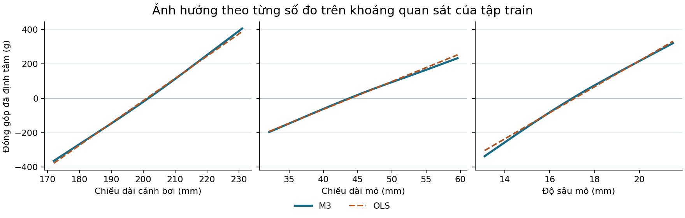

# OLS và Natural Cubic Smoothing Spline tuần 1

Nguyễn Đức Hưng (TV3) · Lab 01 · 20/11/2026

OLS là baseline tuyến tính để xem ba số đo, loài và giới tính dự đoán khối lượng tốt đến đâu với hệ số dễ diễn giải. M3 dùng ba hàm làm mượt riêng để cho phép độ dốc thay đổi theo kích thước. Trên tập test của tuần 1, hai mô hình có sai số gần bằng nhau.

## Dữ liệu và tiền xử lý

Hai mô hình dùng cùng CSV Palmer Penguins và dự đoán `body_mass_g` theo gram. Sau khi loại hai dòng thiếu biến đích, pipeline chung chia 273 mẫu train và 69 mẫu test theo tỷ lệ 80/20 với seed 42. Ba số đo được điền trung vị và chuẩn hóa. `species` và `sex` được điền mức phổ biến nhất rồi mã hóa one-hot với mức tham chiếu lần lượt là Adelie và female. Thống kê tiền xử lý được học trong phần huấn luyện của từng fold khi chọn λ và trên toàn bộ train khi fit mô hình cuối. 69 mẫu test dùng để tính các chỉ số sau khi chốt cấu hình. [Pipeline chung](../source/modeling.py)

## OLS

Với $z_i$ là ba số đo đã chuẩn hóa và $d_i$ là các cột one-hot, OLS dự đoán $\hat y_i=\beta_0+z_i^\top\beta+d_i^\top\gamma$ bằng cách tối thiểu hóa $\sum_i(y_i-\hat y_i)^2$. Baseline dùng `sklearn.linear_model.LinearRegression`. [Tài liệu scikit-learn](https://scikit-learn.org/1.8/modules/generated/sklearn.linear_model.LinearRegression.html)

| Thành phần | Hệ số | Diễn giải khi giữ các biến còn lại cố định |
| --- | ---: | --- |
| Hệ số chặn | 3.643,308 g | Dự đoán cho Adelie cái có cả ba số đo ở trung bình train |
| Chiều dài cánh bơi | +183,848 g | Thay đổi dự đoán khi tăng một độ lệch chuẩn train |
| Chiều dài mỏ | +89,523 g | Thay đổi dự đoán khi tăng một độ lệch chuẩn train |
| Độ sâu mỏ | +147,701 g | Thay đổi dự đoán khi tăng một độ lệch chuẩn train |
| Chinstrap | −227,573 g | Chênh lệch so với Adelie |
| Gentoo | +1.128,305 g | Chênh lệch so với Adelie |
| Đực | +411,121 g | Chênh lệch so với cái |

## M3 spline làm mượt cộng tính

Mô hình có dạng $\hat y_i=\beta_0+f_1(z_{i1})+f_2(z_{i2})+f_3(z_{i3})+d_i^\top\gamma$. Ba biến `flipper_length_mm`, `bill_length_mm` và `bill_depth_mm` là số đo liên tục, nên mỗi biến có một đường cong riêng để ước lượng quan hệ với khối lượng khi giữ các đầu vào khác cố định. Loài và giới tính dịch mức dự đoán qua $d_i^\top\gamma$. Mô hình giả định các đóng góp cộng được với nhau và dùng chung hình dạng đường cong giữa các loài, giới tính.

M3 tối thiểu hóa tổng bình phương phần dư cộng với $\lambda\sum_{j=1}^3\int_{a_j}^{b_j}[f_j''(u)]^2\,du$, với $a_j,b_j$ là hai đầu khoảng train của số đo đã chuẩn hóa. λ càng lớn thì độ cong bị phạt càng mạnh và đường cong càng gần đường thẳng. Mỗi spline là bậc ba từng đoạn với $f_j''(a_j)=f_j''(b_j)=0$. Ngoài khoảng train, dự đoán tiếp tục theo tiếp tuyến ở đầu mút tương ứng. [Tài liệu SciPy về spline làm mượt](https://docs.scipy.org/doc/scipy-1.16.0/tutorial/interpolate/smoothing_splines.html)

Backfitting cập nhật lần lượt từng spline trên phần dư sau khi trừ hệ số chặn, hiệu ứng phân loại và hai spline còn lại. Khi nhiều cá thể có cùng số đo, dùng trung bình phần dư tại giá trị đó và truyền số cá thể làm trọng số cho `make_smoothing_spline` để giữ nguyên bài toán bình phương tối thiểu. Mỗi đường được trừ đi trung bình đóng góp trên các cá thể train để hệ số chặn có cách xác định riêng. Sau khi cập nhật ba đường, OLS cập nhật hệ số chặn và hiệu ứng phân loại trên phần dư còn lại. Lượt fit cuối dừng sau 88 vòng khi mức thay đổi lớn nhất của từng thành phần trên train đạt ngưỡng 0,01 g. Giới hạn là 300 vòng. [API SciPy](https://docs.scipy.org/doc/scipy/reference/generated/scipy.interpolate.make_smoothing_spline.html) · [Buja, Hastie và Tibshirani, 1989](https://doi.org/10.1214/aos/1176347115)

Tuần 1 dùng chung một λ cho ba số đo đã chuẩn hóa. CV 5 fold trên train, có xáo trộn với seed 42, cho MAE trung bình lần lượt là 233,619 g, 230,297 g, 226,504 g và 225,235 g ứng với λ = 0,1, 1, 10 và 100. Cấu hình ban đầu dùng λ = 100, mức có MAE CV thấp nhất trong bốn giá trị thử.

## Kết quả trên 69 mẫu test

| Mô hình | MAE (g) | RMSE (g) | R² |
| --- | ---: | ---: | ---: |
| OLS | 256,683 | 307,005 | 0,832915 |
| M3 | 256,187 | 306,986 | 0,832936 |

M3 giảm MAE khoảng 0,50 g và RMSE khoảng 0,02 g. Đây là chênh lệch nhỏ trên một lần chia dữ liệu. Các đường M3 ở λ = 100 gần với đường thẳng OLS trong khoảng quan sát. Hiệu ứng ước lượng có thể kém ổn định khi các số đo tương quan mạnh hoặc mẫu nằm xa miền train. Cả hai mô hình mô tả mối liên hệ có điều kiện trong dữ liệu khảo sát.



Trục ngang hiển thị số đo gốc theo mm. Trục dọc hiển thị đóng góp dự đoán theo gram sau khi định tâm trên train, giữ các đầu vào khác cố định.

## Chạy lại

Từ thư mục gốc, mở môi trường Python 3.11 hoặc 3.12 theo hướng dẫn của repo rồi chạy các lệnh sau. Lệnh `--select-lam` chạy riêng CV trên train. [Thiết lập môi trường](../README.md#chạy-notebook)

```bash
python -m pip install -r requirements.txt
python -m source.models.m3 --select-lam
python -m source.models.ols
python -m source.models.m3
python -m unittest discover -s tests -v
```

Khởi động lại kernel và chạy tất cả các cell để xem M3 trong notebook. Ở mục 5, chọn M3 và thay đổi lần lượt các số đo để xem đường dự đoán có điều kiện. Hai hàm `build_model()` cũng trả về pipeline dùng trực tiếp với `fit` và `predict`. [Notebook chung](../source/lab01.ipynb)
