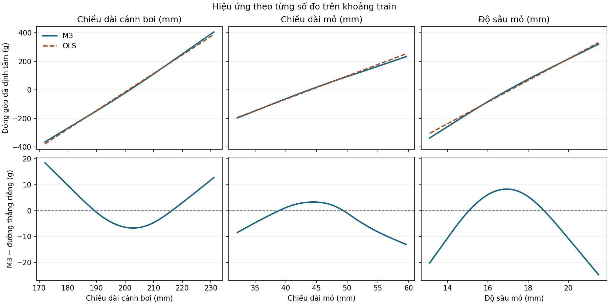

## 3.3 Đánh giá và diễn giải mô hình

### Dữ liệu và thiết kế đánh giá

Bộ Palmer Penguins có 344 dòng. Sau khi loại 2 dòng thiếu khối lượng, các mô hình dùng cùng 273 mẫu train và 69 mẫu test theo split 80/20 với seed 42. Đầu vào gồm chiều dài cánh bơi, chiều dài mỏ, độ sâu mỏ, loài và giới tính. Pipeline điền trung vị rồi chuẩn hóa số đo, điền mode rồi mã hóa one-hot cho biến phân loại. Hai mức tham chiếu là Adelie và female. Khi chạy CV 5 fold xáo trộn với seed 42, mỗi fold fit lại toàn bộ pipeline trên phần huấn luyện của fold. Các chẩn đoán OLS và đường tác động M3 dùng train. Tập test dùng cho đánh giá và bootstrap chênh lệch sau khi cấu hình đã chốt. [Pipeline và split](../source/modeling.py)

Ký hiệu $e_i=y_i-\hat y_i$. MAE là trung bình $|e_i|$, MSE là trung bình $e_i^2$ và RMSE là căn bậc hai của MSE. MAE và RMSE đo bằng gram, còn MSE đo bằng g². RMSE nhạy hơn với sai số lớn. $R^2=1-\sum_i e_i^2/\sum_i(y_i-\bar y)^2$ đo mức cải thiện từ mốc dự đoán bằng trung bình của tập đang đánh giá. Trên train, adjusted $R^2=1-(1-R^2)(n-1)/(n-k-1)$ điều chỉnh theo số hệ số dốc $k$.

### OLS trên train và suy luận hệ số

`statsmodels.api.OLS` dùng chính ma trận đã biến đổi từ sklearn, thêm cột hằng và giữ tên cột theo encoder. Sai khác tuyệt đối lớn nhất giữa hai bộ dự đoán train là $8{,}19 \times 10^{-12}$ g. OLS tối thiểu hóa $\sum_i e_i^2$. Mô hình có $R^2=0{,}8800$, adjusted $R^2=0{,}8773$ và $F(6,266)=325{,}11$ ($p=2{,}39\times10^{-119}$). Kiểm định F cổ điển xét đồng thời giả thuyết $H_0$ rằng cả sáu hệ số dốc bằng 0. Kiểm định Wald dạng F với HC3 cũng cho bằng chứng chống lại giả thuyết đó ($F=369{,}35$, $p=7{,}20\times10^{-126}$). [Statsmodels OLSResults](https://www.statsmodels.org/v0.14.6/generated/statsmodels.regression.linear_model.OLSResults.html)

**Bảng 3.3.1. Hệ số OLS và suy luận trên 273 mẫu train.** SE và CI cùng đơn vị với hệ số. CI là khoảng tin cậy 95%. Các kiểm định t hai phía xét từng hệ số bằng 0, với $t=\hat\beta/SE$. Các p-value theo từng hệ số dùng ngưỡng 5% danh nghĩa.

| Cột sau tiền xử lý | Hệ số | SE cổ điển | t | p | CI cổ điển | SE HC3 | t HC3 | p HC3 | CI HC3 |
| --- | ---: | ---: | ---: | ---: | --- | ---: | ---: | ---: | --- |
| Hệ số chặn | 3643,31 | 74,10 | 49,17 | 1,58e−135 | [3497,42 đến 3789,20] | 70,93 | 51,36 | 4,37e−140 | [3503,64 đến 3782,97] |
| `flipper_length_mm` | +183,85 | 44,94 | 4,09 | 5,71e−5 | [95,36 đến 272,34] | 41,73 | 4,41 | 1,53e−5 | [101,68 đến 266,01] |
| `bill_length_mm` | +89,52 | 42,02 | 2,13 | 0,03405 | [6,79 đến 172,26] | 39,05 | 2,29 | 0,02266 | [12,63 đến 166,41] |
| `bill_depth_mm` | +147,70 | 41,13 | 3,59 | 3,92e−4 | [66,72 đến 228,68] | 41,09 | 3,59 | 3,87e−4 | [66,80 đến 228,61] |
| `species_Chinstrap` | −227,57 | 88,63 | −2,57 | 0,01079 | [−402,08 đến −53,07] | 87,65 | −2,60 | 0,00995 | [−400,15 đến −54,99] |
| `species_Gentoo` | +1128,31 | 142,14 | 7,94 | 5,77e−14 | [848,45 đến 1408,16] | 136,03 | 8,29 | 5,49e−15 | [860,48 đến 1396,13] |
| `sex_male` | +411,12 | 50,74 | 8,10 | 1,97e−14 | [311,21 đến 511,03] | 51,30 | 8,01 | 3,51e−14 | [310,11 đến 512,13] |

Giữ các đầu vào còn lại cố định, tăng một độ lệch chuẩn train của cánh bơi, chiều dài mỏ và độ sâu mỏ lần lượt tương ứng với khoảng +184 g, +90 g và +148 g dự đoán. Hệ số chặn là dự đoán cho Adelie cái có cả ba số đo ở trung bình train. Chinstrap thấp hơn khoảng 228 g và Gentoo cao hơn khoảng 1128 g so với Adelie ở cùng các đầu vào khác. Chim đực cao hơn khoảng 411 g so với chim cái theo mô hình. Các đối chiếu với những tổ hợp đặc trưng hiếm giữa các loài cần được đọc thận trọng.

SE cổ điển dùng giả định phương sai sai số đồng nhất. HC3 giữ nguyên hệ số và điều chỉnh ước lượng hiệp phương sai bằng cách dùng phần dư bình phương có hiệu chỉnh leverage, giúp suy luận tiệm cận bền vững hơn trước phương sai không đồng nhất khi quan sát độc lập. Cả hai cách cho cùng dấu và CI 95% loại 0 cho sáu hệ số dốc ở mức danh nghĩa. Trong số đó chiều dài mỏ có p HC3 lớn nhất và cận dưới gần 0 nhất.

p-value là xác suất quan sát thống kê ít nhất cực đoan như kết quả hiện tại nếu giả thuyết không và các giả định kiểm định đúng. CI 95% mô tả độ bao phủ dài hạn của thủ tục lập khoảng khi lặp lấy mẫu dưới các giả định phù hợp. Kết quả ở đây phản ánh liên hệ có điều kiện theo đặc tả hồi quy trên dữ liệu quan sát. [Hiệp phương sai robust và HC3](https://www.statsmodels.org/v0.14.6/generated/statsmodels.regression.linear_model.OLSResults.get_robustcov_results.html)

### Giả định, đa cộng tuyến và quan sát có ảnh hưởng

Diễn giải OLS dựa vào dạng hàm trung bình được chỉ định, $E[\varepsilon\mid X]=0$, thiết kế đủ hạng và tính độc lập phù hợp của quan sát. Suy luận cổ điển dùng phương sai đồng nhất và dựa thêm vào chuẩn tính của sai số cho các kiểm định hữu hạn mẫu chính xác. Các chẩn đoán sau dùng phần dư train và mang tính thăm dò. Chúng không xác minh được ngoại sinh hay tính độc lập. Điều chỉnh HC3 xử lý phương sai không đồng nhất, còn lệch dạng hàm và phụ thuộc giữa quan sát vẫn có thể làm hạn chế cách suy luận.

**Bảng 3.3.2. Chẩn đoán OLS trên train.** Mỗi dòng so sánh với $H_0$ tương ứng ở mức 5% danh nghĩa.

| Kiểm định | $H_0$ | Thống kê | p | Diễn giải |
| --- | --- | ---: | ---: | --- |
| Ramsey RESET với HC3 | Hệ số của bình phương và lập phương giá trị fitted bổ sung đều bằng 0 | F(2,264) = 3,408 | 0,0346 | Có dấu hiệu dạng hàm tuyến tính cộng tính bỏ sót cấu trúc trung bình |
| Jarque–Bera | Độ lệch và độ nhọn của phần dư phù hợp với chuẩn | χ²(2) = 1,600 | 0,4494 | Chưa đủ bằng chứng về lệch chuẩn qua hai mômen này |
| Breusch–Pagan phiên bản Koenker | Phương sai sai số không phụ thuộc vào các cột giải thích trong kiểm định | LM χ²(6) = 7,631 | 0,2664 | Chưa phát hiện bằng chứng phương sai không đồng nhất theo đặc tả kiểm định |

LOWESS của phần dư theo fitted và chiều dài cánh bơi hơi võng xuống ở giữa. Theo độ sâu mỏ, đường cong nhô lên nhẹ ở giữa. Các dấu hiệu nhỏ này phù hợp với việc kiểm tra thêm dạng hàm. RESET là kiểm định tổng thể nên kết quả không chỉ ra biến nào cần spline hay tương tác nào bị bỏ sót. Histogram và Q–Q gần dạng chuẩn ở phần trung tâm, với lệch nhỏ ở đuôi trên. Không bác bỏ Jarque–Bera hay Koenker vẫn cho phép tồn tại sai lệch mà các kiểm định có độ nhạy hạn chế. [RESET](https://www.statsmodels.org/v0.14.6/generated/statsmodels.stats.diagnostic.linear_reset.html) · [Jarque–Bera](https://www.statsmodels.org/v0.14.6/generated/statsmodels.stats.stattools.jarque_bera.html) · [Breusch–Pagan/Koenker](https://www.statsmodels.org/v0.14.6/generated/statsmodels.stats.diagnostic.het_breuschpagan.html)

**Hình 3.3.1.** Phần dư thực tế trừ dự đoán theo fitted và ba số đo. Histogram và Q–Q khảo sát hình dạng phân phối phần dư trên cùng tập train.

Tương quan Pearson train giữa cánh bơi và chiều dài mỏ là 0,651, giữa cánh bơi và độ sâu mỏ là −0,573, giữa chiều dài và độ sâu mỏ là −0,226. Pearson xét từng cặp số đo. VIF kiểm tra mỗi cột sau tiền xử lý với tất cả cột còn lại, theo $VIF_j=1/(1-R_j^2)$ với $R_j^2$ từ hồi quy phụ có hệ số chặn.

**Bảng 3.3.3.** VIF từ ma trận OLS trên train, bỏ cột hằng khỏi bảng.

| Cánh bơi | Chiều dài mỏ | Độ sâu mỏ | Chinstrap | Gentoo | Đực |
| ---: | ---: | ---: | ---: | ---: | ---: |
| 6,78 | 5,93 | 5,68 | 4,35 | 15,74 | 2,16 |

VIF của Gentoo cao nhất. Trong mẫu, chỉ báo Gentoo có nhiều thông tin trùng với các số đo và cột giải thích còn lại. Sự trùng lặp làm tăng độ bất định khi tách riêng liên hệ của từng biến, dù dự đoán tổng thể vẫn có thể ổn định. VIF là thước đo theo cách mã hóa hiện tại. Các ngưỡng tham khảo dùng để nhận diện vấn đề, chẳng hạn VIF lớn hơn 5, không phải ngưỡng kiểm định. [VIF trong statsmodels](https://www.statsmodels.org/v0.14.6/generated/statsmodels.stats.outliers_influence.variance_inflation_factor.html)

Leverage $h_{ii}$ đo độ khác biệt của đầu vào so với thiết kế train. Phần dư studentized ngoại bộ chuẩn hóa phần dư bằng ước lượng độ lệch chuẩn khi bỏ quan sát đó khỏi phép tính phương sai. Cook’s distance kết hợp độ lớn phần dư và leverage để đo mức thay đổi của giá trị fitted khi bỏ một điểm. Với $n=273$ và 7 hệ số, quy tắc rà soát cho 1 điểm có $|r_{\text{studentized}}|>3$, 6 điểm có $h_{ii}>2(7)/273$ và 16 điểm có Cook’s distance $>4/273$.

**Bảng 3.3.4.** Ba quan sát train có Cook’s distance lớn nhất. Chỉ số CSV bắt đầu từ 0, bỏ qua dòng tiêu đề.

| Chỉ số CSV | Loài, giới tính | Thực tế (g) | Fitted (g) | Phần dư (g) | Studentized | Leverage | Cook |
| ---: | --- | ---: | ---: | ---: | ---: | ---: | ---: |
| 324 | Chinstrap, đực | 3250 | 3885,6 | −635,6 | −2,30 | 0,042 | 0,03255 |
| 9 | Adelie, thiếu giới tính | 4250 | 3700,5 | +549,5 | +1,99 | 0,055 | 0,03255 |
| 292 | Chinstrap, đực | 3300 | 4094,2 | −794,2 | −2,86 | 0,027 | 0,03161 |

Dòng 9 có leverage cao hơn hai dòng còn lại và giới tính được pipeline điền bằng mode train. Dòng 292 có phần dư lớn hơn nhưng leverage thấp hơn. Cả ba được giữ nguyên trong đánh giá. Mức độ ảnh hưởng chỉ xác định điểm cần xem xét khi diễn giải mô hình. [OLSInfluence](https://www.statsmodels.org/v0.14.6/generated/statsmodels.stats.outliers_influence.OLSInfluence.html)

### M3 và hình dạng của các hiệu ứng

M3 là mô hình cộng tính $\hat y=\beta_0+\sum_{j=1}^3 f_j(z_j)+d^\top\gamma$. Ba $z_j$ là các số đo đã chuẩn hóa. Các cột one-hot $d$ cho phép dịch mức dự đoán theo loài và giới tính. M3 tối thiểu hóa $\sum_i e_i^2+\lambda\sum_j\int_{a_j}^{b_j} [f_j''(u)]^2\,du$. Điều kiện natural $f_j''(a_j)=f_j''(b_j)=0$ tại hai biên train đi kèm ngoại suy theo tiếp tuyến. Backfitting lần lượt dùng phần dư sau khi loại các thành phần còn lại, định tâm đường ước lượng và cập nhật các hiệu ứng tuyến tính. [Smoothing spline của SciPy](https://docs.scipy.org/doc/scipy/tutorial/interpolate/smoothing_splines.html) · [Buja, Hastie và Tibshirani, 1989](https://doi.org/10.1214/aos/1176347115)

Cấu hình dùng chung $\lambda=100$ theo MAE CV train, với tập ứng viên 0,1 / 1 / 10 / 100. Lượt fit trên toàn bộ train hội tụ sau 88 vòng với ngưỡng thay đổi 0,01 g và giới hạn 300 vòng. $\lambda$ lớn phạt độ cong mạnh và có thể làm mất cấu trúc có ích. $\lambda$ nhỏ linh hoạt hơn nhưng có thể đuổi theo nhiễu. Vì 100 ở biên trên của lưới ban đầu, kết quả chỉ mô tả cấu hình đã thử. [Thử nghiệm chọn λ](ols-m3-week1.md)

**Hình 3.3.2.** Hàng trên so sánh đóng góp đã định tâm của M3 và OLS theo số đo gốc. Hàng dưới trừ đường thẳng gần nhất của chính spline, ước lượng bằng bình phương tối thiểu tại các số đo train. Cách này tách độ cong khỏi chênh lệch hệ số dốc giữa hai mô hình.

**Bảng 3.3.5.** Độ lệch so với đường thẳng riêng của mỗi spline. RMS tính tại các quan sát train và max lấy trên lưới 250 điểm trong khoảng train.

| Số đo | RMS độ lệch (g) | Độ lệch tuyệt đối lớn nhất trên lưới (g) |
| --- | ---: | ---: |
| Chiều dài cánh bơi | 5,28 | 18,47 |
| Chiều dài mỏ | 3,04 | 13,04 |
| Độ sâu mỏ | 7,77 | 24,72 |

Độ sâu mỏ có độ cong thấy rõ nhất trên thang chênh lệch, tiếp theo là cánh bơi. Chiều dài mỏ gần tuyến tính nhất. Mức cong nhìn chung nhỏ so với RMSE test khoảng 307 g. Các giá trị này mô tả đường đã fit. Spline được ước lượng đồng thời bằng backfitting, có phạt và dùng λ do CV chọn. Bảng t-test cổ điển cho hệ số OLS không phải phép suy luận hợp lệ cho độ cong của những đường này. Các mô tả hình dạng và bằng chứng dự đoán được báo riêng.

### Độ ổn định và hiệu năng dự đoán

**Bảng 3.3.6.** Trung bình ± độ lệch chuẩn mẫu giữa 5 fold train. Hai mô hình dùng cùng phân hoạch. Vì các fold này cũng được dùng để chọn λ, kết quả M3 là mô tả sau lựa chọn, có thể lạc quan. Độ lệch chuẩn giữa các fold mô tả biến thiên giữa fold, không phải CI cho hiệu năng tổng thể.

| Mô hình | MAE (g) | MSE (g²) | RMSE (g) | R² |
| --- | ---: | ---: | ---: | ---: |
| OLS | 225,59 ± 17,19 | 84 042,93 ± 11 682,63 | 289,29 ± 21,08 | 0,86624 ± 0,02278 |
| M3 | 225,24 ± 17,84 | 83 662,40 ± 11 914,26 | 288,60 ± 21,61 | 0,86681 ± 0,02348 |

RMSE CV là trung bình của RMSE từng fold. Sau khi chốt cấu hình, mỗi pipeline được fit lại trên toàn bộ train để tạo dự đoán cho cùng 69 mẫu test.

**Bảng 3.3.7.** Kết quả held-out sau khi fit trên toàn bộ train.

| Mô hình | MAE (g) | MSE (g²) | RMSE (g) | R² |
| --- | ---: | ---: | ---: | ---: |
| OLS | 256,683 | 94 252,10 | 307,005 | 0,832915 |
| M3 | 256,187 | 94 240,19 | 306,986 | 0,832936 |

**Hình 3.3.3.** Mỗi điểm là một cá thể test. Đường chéo biểu thị dự đoán bằng giá trị thực. Phần dư trung bình của OLS và M3 lần lượt là −17,31 g và −16,02 g, tương ứng với dự đoán cao nhẹ trên mẫu test. Khoảng tứ phân vị lần lượt là [−200,80 đến 247,47] g và [−199,94 đến 238,33] g. Độ lệch chuẩn phần dư cả hai khoảng 309 g.

**Bảng 3.3.8.** Sai số test theo loài hoặc giới tính. Hai cách nhóm dùng lại cùng các cá thể. Bốn dòng thiếu giới tính được pipeline điền mode khi dự đoán và giữ thành nhóm riêng khi báo cáo.

| Nhóm | n | OLS MAE (g) | M3 MAE (g) | OLS RMSE (g) | M3 RMSE (g) |
| --- | ---: | ---: | ---: | ---: | ---: |
| Adelie | 35 | 262,73 | 264,21 | 312,49 | 314,08 |
| Chinstrap | 11 | 286,24 | 282,42 | 312,32 | 309,49 |
| Gentoo | 23 | 233,35 | 231,43 | 295,83 | 294,61 |
| Cái | 29 | 224,74 | 224,68 | 257,81 | 258,02 |
| Đực | 36 | 278,67 | 277,85 | 331,92 | 331,71 |
| Thiếu giới tính | 4 | 290,36 | 289,63 | 390,43 | 390,82 |

Sai số MAE ở nhóm đực cao hơn nhóm cái cho cả hai mô hình. So sánh mô hình theo nhóm chỉ mang tính mô tả, nhất là Chinstrap có 11 mẫu và nhóm thiếu giới tính có 4 mẫu.

### Bootstrap theo cặp và kết luận

Mỗi lượt bootstrap lấy có hoàn lại 69 chỉ số test rồi dùng **cùng các chỉ số** để chọn bộ phần dư OLS và M3. Tính lại hiệu $M3-OLS$ của từng metric trên mẫu đó. Giữ cố định hai pipeline đã fit, lặp 2 000 lượt với seed 42 và lấy phân vị 2,5% và 97,5%. [Paired bootstrap trong SciPy](https://docs.scipy.org/doc/scipy/reference/generated/scipy.stats.bootstrap.html)

**Bảng 3.3.9.** Chênh lệch điểm và CI 95% percentile. Hiệu âm tương ứng với lỗi thấp hơn của M3.

| Chênh lệch M3 − OLS | Ước lượng (g) | CI 95% (g) |
| --- | ---: | --- |
| ΔMAE | −0,497 | [−2,608 đến +1,607] |
| ΔRMSE | −0,019 | [−2,172 đến +2,093] |

Cả hai khoảng chứa 0, nên tập test này chưa cho bằng chứng đủ rõ rằng M3 giảm sai số. Về thực tế, giảm khoảng 0,50 g MAE trên nền khoảng 257 g là rất nhỏ. Kết quả cũng không thiết lập tương đương theo một biên định trước. Bootstrap giả định các cặp theo cá thể có thể lấy mẫu như những đơn vị độc lập và chỉ phản ánh biến thiên mẫu đánh giá có điều kiện trên hai mô hình đã fit. Kết quả không bao quát biến thiên do huấn luyện lại, đổi bộ dữ liệu hay lấy mẫu theo cụm. Cấu hình không được cập nhật theo test.

### Tái lập và tài liệu

Từ thư mục gốc trong môi trường đã cài `requirements.txt`, chạy `python -m source.evaluation` để in các bảng và tái tạo ba hình. Chạy `python -m unittest discover -s tests -v` để kiểm tra tính nhất quán của ma trận hồi quy, split, bootstrap và các đầu ra. [Script phân tích](../source/evaluation.py)

- Dữ liệu của Horst, Hill và Gorman (2020). [Palmer Penguins](https://doi.org/10.5281/zenodo.3960218)
- Suy luận tuyến tính, hiệp phương sai robust, chẩn đoán và ảnh hưởng. [Statsmodels 0.14.6](https://www.statsmodels.org/v0.14.6/stats.html)
- Phương pháp spline cộng tính và backfitting. [Buja, Hastie và Tibshirani, 1989](https://doi.org/10.1214/aos/1176347115)
- Đánh giá qua K-fold và bootstrap theo cặp. [KFold](https://scikit-learn.org/1.8/modules/generated/sklearn.model_selection.KFold.html) · [SciPy bootstrap](https://docs.scipy.org/doc/scipy/reference/generated/scipy.stats.bootstrap.html)
