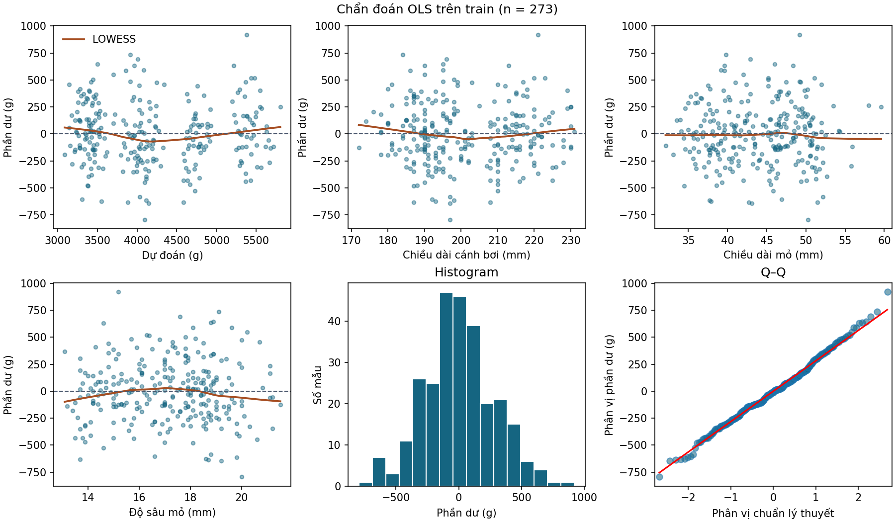
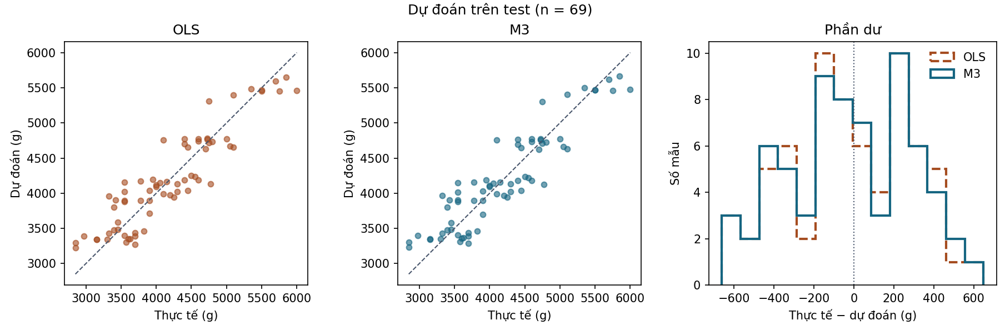

## 3.3 Đánh giá và diễn giải mô hình

### Dữ liệu và thiết kế đánh giá

Bộ Palmer Penguins có 344 dòng. Sau khi loại 2 dòng thiếu khối lượng, các mô hình dùng cùng 273 mẫu train và 69 mẫu test theo split 80/20 với seed 42. Đầu vào gồm chiều dài cánh bơi, chiều dài mỏ, độ sâu mỏ, loài và giới tính theo bộ biến chung của nhóm. Pipeline OLS và M3 điền trung vị rồi chuẩn hóa số đo, điền mode rồi mã hóa one-hot cho biến phân loại. Hai mức tham chiếu là Adelie và female. CV dùng `KFold(n_splits=5, shuffle=True, random_state=42)`. Toàn bộ pipeline được fit trong phần huấn luyện của từng fold. Chẩn đoán OLS, chọn λ và đường tác động M3 dùng train. Tập 69 mẫu đã được đánh giá từ tuần 1 và được giữ nguyên để so sánh sau khi chốt cấu hình trên train. [Pipeline và split](../source/modeling.py) · [Giao thức của Issue #9](https://github.com/phuctran33/regression-lab01/issues/9)

Ký hiệu $e_i=y_i-\hat y_i$. MAE là trung bình $|e_i|$, MSE là trung bình $e_i^2$ và RMSE là căn bậc hai của MSE. MAE và RMSE đo bằng gram, còn MSE đo bằng g². RMSE nhạy hơn với sai số lớn. $R^2=1-\sum_i e_i^2/\sum_i(y_i-\bar y)^2$ đo mức cải thiện từ mốc dự đoán bằng trung bình của tập đang đánh giá. Trên train, adjusted $R^2=1-(1-R^2)(n-1)/(n-k-1)$ điều chỉnh theo số hệ số dốc $k$.

### OLS trên train và suy luận hệ số

OLS là mô hình gốc để khảo sát mức độ giải thích của một hệ số dốc cố định cho từng số đo. Mô hình $\hat y=\hat\beta_0+\sum_{j=1}^3\hat\beta_j z_j+d^\top\hat\gamma$ tối thiểu hóa $SSE=\sum_i e_i^2$. Ba $z_j$ là số đo đã chuẩn hóa và $d$ chứa các biến giả của loài, giới tính. Chuẩn hóa đưa ba số đo về cùng cách đọc theo độ lệch chuẩn train. Mã hóa bỏ một mức mỗi nhóm cho phép giữ hệ số chặn và diễn giải chênh lệch theo mức tham chiếu. `statsmodels.api.OLS` dùng chính ma trận đã biến đổi từ sklearn, thêm cột hằng và giữ tên cột theo encoder. Sai khác dự đoán train lớn nhất là $8{,}19\times10^{-12}$ g.

Mô hình có $R^2=0{,}8800$ và adjusted $R^2=0{,}8773$. Với 273 mẫu và 7 hệ số kể cả hệ số chặn, bậc tự do phần dư là $273-7=266$. $SSE=21\,640\,248{,}36$ g², phương sai sai số cổ điển ước lượng là $s^2=SSE/266=81\,354{,}32$ g² và residual standard error là $s=285{,}23$ g. $s$ mô tả độ phân tán phần dư train sau điều chỉnh bậc tự do. [ISLP, Ch. 3](https://doi.org/10.1007/978-3-031-38747-0_3) · [Statsmodels OLSResults](https://www.statsmodels.org/v0.14.6/generated/statsmodels.regression.linear_model.OLSResults.html)

**Bảng 3.3.1. Hệ số OLS và suy luận trên 273 mẫu train.** Với mỗi hệ số, $H_0$ là hệ số bằng 0 và $H_1$ là hệ số khác 0, giữ các cột còn lại trong mô hình. Kiểm định hai phía dùng $t=\hat\beta/SE$ với 266 bậc tự do và $\alpha=0{,}05$ danh nghĩa cho từng hệ số. CI 95% dùng $\hat\beta\pm t_{0{,}975;266}SE$, tương ứng với SE cổ điển hoặc HC3.

| Cột sau tiền xử lý | Hệ số | SE cổ điển | t | p | CI cổ điển | SE HC3 | t HC3 | p HC3 | CI HC3 |
| --- | ---: | ---: | ---: | ---: | --- | ---: | ---: | ---: | --- |
| Hệ số chặn | 3643,31 | 74,10 | 49,17 | 1,58e−135 | [3497,42 đến 3789,20] | 70,93 | 51,36 | 4,37e−140 | [3503,64 đến 3782,97] |
| `flipper_length_mm` | +183,85 | 44,94 | 4,09 | 5,71e−5 | [95,36 đến 272,34] | 41,73 | 4,41 | 1,53e−5 | [101,68 đến 266,01] |
| `bill_length_mm` | +89,52 | 42,02 | 2,13 | 0,03405 | [6,79 đến 172,26] | 39,05 | 2,29 | 0,02266 | [12,63 đến 166,41] |
| `bill_depth_mm` | +147,70 | 41,13 | 3,59 | 3,92e−4 | [66,72 đến 228,68] | 41,09 | 3,59 | 3,87e−4 | [66,80 đến 228,61] |
| `species_Chinstrap` | −227,57 | 88,63 | −2,57 | 0,01079 | [−402,08 đến −53,07] | 87,65 | −2,60 | 0,00995 | [−400,15 đến −54,99] |
| `species_Gentoo` | +1128,31 | 142,14 | 7,94 | 5,77e−14 | [848,45 đến 1408,16] | 136,03 | 8,29 | 5,49e−15 | [860,48 đến 1396,13] |
| `sex_male` | +411,12 | 50,74 | 8,10 | 1,97e−14 | [311,21 đến 511,03] | 51,30 | 8,01 | 3,51e−14 | [310,11 đến 512,13] |

Giữ các đầu vào còn lại cố định, tăng một độ lệch chuẩn train của cánh bơi, chiều dài mỏ và độ sâu mỏ lần lượt tương ứng với khoảng +184 g, +90 g và +148 g dự đoán. Hệ số chặn là dự đoán cho Adelie cái có cả ba số đo ở trung bình train. Chinstrap thấp hơn khoảng 228 g và Gentoo cao hơn khoảng 1128 g so với Adelie ở cùng các đầu vào khác. Chim đực cao hơn khoảng 411 g so với chim cái theo mô hình. Các đối chiếu với những tổ hợp đặc trưng hiếm giữa các loài cần được đọc thận trọng.

SE cổ điển dùng giả định phương sai sai số đồng nhất. HC3 giữ nguyên hệ số và điều chỉnh ma trận hiệp phương sai bằng $e_i^2/(1-h_{ii})^2$, giúp suy luận tiệm cận bền vững hơn trước phương sai không đồng nhất khi quan sát độc lập. Với cả hai cách, CI 95% của sáu hệ số dốc đều loại 0. Chiều dài mỏ có bằng chứng yếu nhất trong sáu hệ số ($p_\mathrm{HC3}=0{,}02266$). Đây là các kiểm định từng hệ số ở mức danh nghĩa, chưa hiệu chỉnh đồng thời. [Hiệp phương sai robust và HC3](https://www.statsmodels.org/v0.14.6/generated/statsmodels.regression.linear_model.OLSResults.get_robustcov_results.html)

p-value là xác suất, dưới $H_0$ và các giả định của kiểm định, thu được thống kê ít nhất cũng cực đoan như giá trị quan sát. CI 95% mô tả độ bao phủ dài hạn của thủ tục lập khoảng khi lặp lấy mẫu dưới các giả định phù hợp. Vì đây là dữ liệu quan sát, các hệ số được diễn giải như liên hệ có điều kiện theo đặc tả hồi quy.

### Kiểm định F toàn mô hình và kiểm định chung cho loài

Kiểm định toàn mô hình hỏi liệu sáu cột giải thích có cải thiện fit so với mô hình chỉ có hệ số chặn. $H_0$ đặt cả sáu hệ số dốc bằng 0 và $H_1$ cho phép ít nhất một hệ số khác 0. Kiểm định riêng cho `species` hỏi liệu hai cột `species_Chinstrap` và `species_Gentoo` có bổ sung thông tin sau khi giữ ba số đo và giới tính. $H_0$ đặt **cả hai** hệ số bằng 0, với $H_1$ là ít nhất một trong hai khác 0. Đây là câu hỏi về toàn bộ biến phân loại, còn mỗi kiểm định t trong Bảng 3.3.1 đối chiếu một mức cụ thể với Adelie.

**Bảng 3.3.2.** Kiểm định chung trên train ở mức $\alpha=0{,}05$. F cổ điển dùng $(SSE_{\mathrm{rút\ gọn}}-SSE_{\mathrm{đầy\ đủ}})/(q\,s^2)$ với $q$ ràng buộc, dưới giả định OLS cổ điển. Wald dạng F dùng cùng ràng buộc và hiệp phương sai HC3.

| Giả thuyết được xét | Phương pháp | Bậc tự do | F | p-value | Quyết định |
| --- | --- | --- | ---: | ---: | --- |
| Sáu hệ số dốc bằng 0 | F cổ điển | (6, 266) | 325,109 | 2,39e−119 | Bác bỏ $H_0$ |
| Sáu hệ số dốc bằng 0 | Wald F, HC3 | (6, 266) | 369,346 | 7,20e−126 | Bác bỏ $H_0$ |
| Hai hệ số loài bằng 0 | F riêng phần | (2, 266) | 65,553 | 7,16e−24 | Bác bỏ $H_0$ |
| Hai hệ số loài bằng 0 | Wald F, HC3 | (2, 266) | 80,194 | 5,56e−28 | Bác bỏ $H_0$ |

Bằng chứng ủng hộ vai trò của loài trong hàm dự đoán có điều kiện theo đặc tả OLS. Kiểm định chung cho biết có ít nhất một tương phản theo loài. Độ lớn và hướng của từng tương phản nằm trong Bảng 3.3.1. Các kiểm định giả định cấu trúc trung bình phù hợp và quan sát độc lập. Mức chồng lấp giữa các loài về số đo và kết quả RESET bên dưới giới hạn cách diễn giải. [Kiểm định các ràng buộc tuyến tính trong statsmodels](https://www.statsmodels.org/v0.14.6/generated/statsmodels.regression.linear_model.OLSResults.f_test.html)

### Khoảng cho trung bình và cho một cá thể

Dùng bộ đầu vào của một Adelie cái trong train (mẫu chỉ số CSV 130) để minh họa cho cá thể mới cùng đặc trưng. Số đo là **190 mm cánh bơi, 38,5 mm chiều dài mỏ và 17,9 mm độ sâu mỏ**. Dự đoán và hai khoảng được tính bằng cùng hàng thiết kế, kể cả hệ số chặn. Giới hạn và dự đoán trong bảng đều tính bằng gram.

**Bảng 3.3.3.** Dự đoán điểm và khoảng 95% theo OLS cổ điển.

| Dự đoán điểm | SE của trung bình | CI 95% cho trung bình có điều kiện | PI 95% cho cá thể mới |
| ---: | ---: | --- | --- |
| 3 469,93 | 34,01 | [3 402,96 đến 3 536,90] | [2 904,36 đến 4 035,50] |

Với hàng đã tiền xử lý $x_0$, đặt $h_0=x_0^\top(X^\top X)^{-1}x_0$. CI có dạng $\hat y_0\pm t_{0{,}975;266}s\sqrt{h_0}$. PI thay căn bằng $\sqrt{1+h_0}$ vì dự đoán cho một cá thể mới còn chịu nhiễu cá thể có phương sai $\sigma^2$. Vì thế khoảng cho cá thể rộng hơn khoảng cho trung bình của các cá thể cùng đầu vào. Độ bao phủ 95% theo OLS cổ điển dựa trên dạng hàm trung bình đúng, sai số độc lập, chuẩn và cùng phương sai. HC3 có thể điều chỉnh phương sai ước lượng của trung bình, còn PI dưới phương sai thay đổi cần thêm ước lượng phương sai cá thể tại $x_0$. Ví dụ và giao diện dùng hai khoảng cổ điển với các giả định trên. [ISLP, Ch. 3](https://doi.org/10.1007/978-3-031-38747-0_3) · [OLSResults.get_prediction](https://www.statsmodels.org/v0.14.6/generated/statsmodels.regression.linear_model.OLSResults.get_prediction.html)

### Giả định, đa cộng tuyến và quan sát có ảnh hưởng

Diễn giải OLS dựa vào dạng hàm trung bình được chỉ định, $E[\varepsilon\mid X]=0$, thiết kế đủ hạng và tính độc lập phù hợp của quan sát. Suy luận cổ điển dùng phương sai đồng nhất và thêm giả định chuẩn để có kiểm định hữu hạn mẫu chính xác. Thiết kế quan sát có thể có biến bỏ sót hoặc cá thể phụ thuộc theo địa điểm và năm lấy mẫu. HC3 điều chỉnh phương sai không đồng nhất dưới giả định độc lập, còn các chẩn đoán phần dư dưới đây chỉ thăm dò các dạng sai lệch cụ thể. Thứ tự dòng CSV không biểu diễn một chuỗi thời gian để diễn giải kiểm định Durbin–Watson hay Breusch–Godfrey.

**Bảng 3.3.4. Chẩn đoán OLS trên train.** So sánh từng p-value với $\alpha=0{,}05$ danh nghĩa.

| Câu hỏi và kiểm định | $H_0$ | $H_1$ | Thống kê | p | Quyết định |
| --- | --- | --- | ---: | ---: | --- |
| Dạng hàm, Ramsey RESET với HC3 | Hai hệ số của $\hat y^2,\hat y^3$ bổ sung đều bằng 0 | Ít nhất một hệ số bổ sung khác 0 | F(2, 264) = 3,408 | 0,0346 | Bác bỏ $H_0$ |
| Phân phối, Jarque–Bera | Độ lệch bằng 0 và độ nhọn bằng 3 như phân phối chuẩn | Ít nhất một mômen khác giá trị chuẩn | χ²(2) = 1,600 | 0,4494 | Chưa đủ bằng chứng bác bỏ $H_0$ |
| Phương sai, Breusch–Pagan phiên bản Koenker | Phương sai đồng nhất trong đặc tả hồi quy phụ | Phương sai liên hệ với ít nhất một cột giải thích | LM χ²(6) = 7,631 | 0,2664 | Chưa đủ bằng chứng bác bỏ $H_0$ |

- **Dạng hàm.** LOWESS của phần dư theo fitted và chiều dài cánh bơi hơi võng xuống ở giữa. Theo độ sâu mỏ, đường cong nhô lên nhẹ. RESET với HC3 có dấu hiệu dạng hàm bỏ sót cấu trúc trung bình khi dùng các lũy thừa fitted. Kiểm định cần thiết kế mở rộng đủ hạng và dùng suy luận xấp xỉ dưới giả định độc lập. Kết quả là tín hiệu chung để xem xét dạng hàm. Việc quy về một biến cụ thể hoặc kết luận M3 cải thiện dự đoán cần bằng chứng riêng. [RESET](https://www.statsmodels.org/v0.14.6/generated/statsmodels.stats.diagnostic.linear_reset.html)
- **Phân phối.** Histogram và Q–Q gần chuẩn ở phần trung tâm, với lệch nhỏ ở đuôi trên. Jarque–Bera đối chiếu hai mômen với chuẩn bằng phân phối χ² tiệm cận. $p=0{,}4494$ cho biết phép kiểm này chưa phát hiện lệch qua hai mômen, với giả định độc lập phù hợp. Các dạng lệch khác vẫn có thể tồn tại. [Jarque–Bera](https://www.statsmodels.org/v0.14.6/generated/statsmodels.stats.stattools.jarque_bera.html)
- **Phương sai.** Koenker dùng hồi quy phụ của phần dư bình phương với các cột giải thích và hệ số chặn. Dạng này giảm phụ thuộc vào giả định chuẩn so với Breusch–Pagan gốc và dùng kiểm định LM tiệm cận với quan sát độc lập. $p=0{,}2664$ cho biết chưa phát hiện tín hiệu theo các cột đã xét. Báo cả SE cổ điển và HC3 để thấy độ nhạy của suy luận. [Breusch–Pagan/Koenker](https://www.statsmodels.org/v0.14.6/generated/statsmodels.stats.diagnostic.het_breuschpagan.html)



**Hình 3.3.1.** Phần dư thực tế trừ dự đoán theo fitted và ba số đo. Histogram và Q–Q khảo sát hình dạng phân phối phần dư trên cùng tập train.

Tương quan Pearson train giữa cánh bơi và chiều dài mỏ là 0,651, giữa cánh bơi và độ sâu mỏ là −0,573, giữa chiều dài và độ sâu mỏ là −0,226. Pearson xét từng cặp số đo. VIF kiểm tra mỗi cột sau tiền xử lý với tất cả cột còn lại, theo $VIF_j=1/(1-R_j^2)$ với $R_j^2$ từ hồi quy phụ có hệ số chặn.

**Bảng 3.3.5.** VIF từ ma trận OLS trên train, bỏ cột hằng khỏi bảng.

| Cánh bơi | Chiều dài mỏ | Độ sâu mỏ | Chinstrap | Gentoo | Đực |
| ---: | ---: | ---: | ---: | ---: | ---: |
| 6,78 | 5,93 | 5,68 | 4,35 | 15,74 | 2,16 |

VIF của Gentoo cao nhất. Trong mẫu, chỉ báo Gentoo trùng nhiều thông tin với các cột giải thích còn lại. Sự trùng lặp làm tăng độ bất định khi tách riêng từng hệ số, dù dự đoán tổng thể trên các tổ hợp quen thuộc vẫn có thể ổn định. Đây là một động cơ để nhóm xét Ridge. VIF phụ thuộc cách mã hóa hiện tại và các ngưỡng như 5 chỉ là mốc chẩn đoán. [VIF trong statsmodels](https://www.statsmodels.org/v0.14.6/generated/statsmodels.stats.outliers_influence.variance_inflation_factor.html)

Điểm bất thường theo đáp ứng có phần dư studentized ngoại bộ lớn. Thước đo này chia $e_i$ cho $s_{(i)}\sqrt{1-h_{ii}}$, với $s_{(i)}$ ước lượng khi bỏ điểm đang xét. Điểm leverage cao có đầu vào khác thường so với thiết kế train. Điểm ảnh hưởng lớn làm thay đổi fit khi bị bỏ, đo bằng Cook’s distance kết hợp phần dư và leverage. Với $n=273$ và 7 hệ số, quy tắc rà soát cho 1 điểm có $|r_{\text{studentized}}|>3$, 6 điểm có $h_{ii}>2(7)/273$ và 16 điểm có Cook’s distance $>4/273$.

**Bảng 3.3.6.** Ba quan sát train có Cook’s distance lớn nhất. Chỉ số CSV bắt đầu từ 0, bỏ qua dòng tiêu đề.

| Chỉ số CSV | Loài, giới tính | Thực tế (g) | Fitted (g) | Phần dư (g) | Studentized | Leverage | Cook |
| ---: | --- | ---: | ---: | ---: | ---: | ---: | ---: |
| 324 | Chinstrap, đực | 3250 | 3885,6 | −635,6 | −2,30 | 0,042 | 0,03255 |
| 9 | Adelie, thiếu giới tính | 4250 | 3700,5 | +549,5 | +1,99 | 0,055 | 0,03255 |
| 292 | Chinstrap, đực | 3300 | 4094,2 | −794,2 | −2,86 | 0,027 | 0,03161 |

Dòng 9 có leverage cao hơn hai dòng còn lại và giới tính được pipeline điền bằng mode train. Dòng 292 có phần dư lớn hơn nhưng leverage thấp hơn. Cả ba được giữ nguyên trong đánh giá. Mức độ ảnh hưởng chỉ xác định điểm cần xem xét khi diễn giải mô hình. [OLSInfluence](https://www.statsmodels.org/v0.14.6/generated/statsmodels.stats.outliers_influence.OLSInfluence.html)

### M3 và hình dạng của các hiệu ứng

M3 là mô hình cộng tính $\hat y=\beta_0+\sum_{j=1}^3 f_j(z_j)+d^\top\gamma$. Mỗi số đo liên tục có một đường tác động riêng để khảo sát độ cong, còn các biến giả $d$ cho phép dịch mức dự đoán theo loài và giới tính. M3 tối thiểu hóa $\sum_i e_i^2+\lambda\sum_j\int_{a_j}^{b_j}[f_j''(u)]^2\,du$ trên thang số đo đã chuẩn hóa. Điều kiện natural đặt $f_j''(a_j)=f_j''(b_j)=0$ tại hai biên train. Ngoài biên, mô hình ngoại suy theo tiếp tuyến.

Trong mỗi vòng backfitting, từng spline được fit trên phần dư sau khi trừ các thành phần còn lại. Với $n_z$ phần dư $r_i$ cùng số đo $z$, $\sum_{i:z_i=z}(r_i-f(z))^2=n_z(\bar r_z-f(z))^2+\sum_{i:z_i=z}(r_i-\bar r_z)^2$. Hạng sau độc lập với spline, nên có thể fit trên phần dư trung bình $\bar r_z$ với trọng số $n_z$. Mỗi spline được định tâm trên các quan sát train để tách phần hằng khỏi hệ số chặn. Sau ba spline, bình phương tối thiểu cập nhật hệ số chặn và hiệu ứng phân loại. Tiêu chí dừng là thay đổi tuyệt đối lớn nhất của các thành phần dự đoán trên train không vượt 0,01 g trong một vòng, với tối đa 300 vòng. [Smoothing spline có trọng số trong SciPy](https://docs.scipy.org/doc/scipy/reference/generated/scipy.interpolate.make_smoothing_spline.html) · [Buja, Hastie và Tibshirani, 1989](https://doi.org/10.1214/aos/1176347115)

$\lambda$ nhỏ cho phép đường bám sát dữ liệu hơn, thường giảm bias khi quan hệ có độ cong nhưng làm tăng phương sai. $\lambda$ lớn làm mượt mạnh hơn, thường giảm phương sai và có thể tăng bias. Khi $\lambda\to\infty$, các hàm có độ cong bằng 0 được ưu tiên. Chúng là các hàm bậc nhất hoặc hằng số, nên dạng mô hình giới hạn trùng với OLS có cùng thiết kế. M2 tạo số hữu hạn hàm cơ sở cubic spline bằng số nút đã chọn rồi fit hồi quy tuyến tính trên các cột đó. M3 kiểm soát độ trơn qua phạt tích phân của đạo hàm bậc hai. [ISLP, Ch. 7](https://doi.org/10.1007/978-3-031-38747-0_7) · [Cấu hình M2 đã bàn giao](spline-m2-week1.md)

**Bảng 3.3.7.** Chọn λ theo MAE CV trên train. Bốn hàng đầu tái lập kết quả tuần 1. Số vòng ghi theo thứ tự 5 fold. Cả 35 lượt fit hội tụ và không phát cảnh báo hội tụ.

| λ | MAE trung bình ± SD mẫu (g) | Fold hội tụ | Số vòng từng fold |
| ---: | ---: | ---: | --- |
| 0,1 | 233,619 ± 21,820 | 5/5 | 140, 146, 141, 136, 141 |
| 1 | 230,297 ± 22,722 | 5/5 | 127, 126, 128, 123, 127 |
| 10 | 226,504 ± 20,921 | 5/5 | 103, 103, 105, 100, 104 |
| **100** | **225,235 ± 17,838** | 5/5 | 88, 90, 90, 85, 88 |
| 300 | 225,384 ± 17,411 | 5/5 | 85, 88, 89, 83, 86 |
| 1 000 | 225,519 ± 17,259 | 5/5 | 85, 87, 88, 83, 86 |
| 3 000 | 225,563 ± 17,215 | 5/5 | 85, 87, 88, 83, 85 |

Chốt **λ = 100** vì MAE CV thấp nhất và đã nằm trong lòng lưới mở rộng. Với λ lớn hơn, MAE tăng nhẹ về mốc OLS **225,586 g**. Lượt fit λ = 100 trên toàn bộ train hội tụ sau 88 vòng, với thay đổi lớn nhất ở vòng cuối là 0,00954 g. [Kết quả tuần 1](ols-m3-week1.md)


**Hình 3.3.2.** Hàng trên so sánh đóng góp đã định tâm của M3 và OLS theo số đo gốc. Hàng dưới trừ đường thẳng gần nhất của chính spline, ước lượng bằng bình phương tối thiểu tại các số đo train. Cách này tách độ cong khỏi chênh lệch hệ số dốc giữa hai mô hình.

**Bảng 3.3.8.** Độ lệch so với đường thẳng riêng của mỗi spline và chênh lệch với tác động OLS. RMS tính tại các quan sát train. Hai cột cực đại lấy trên lưới 250 điểm trong khoảng train. Các đầu vào khác được giữ cố định khi đọc từng đường tác động.

| Số đo | RMS so với đường thẳng riêng (g) | Cực đại so với đường thẳng riêng (g) | Chênh lệch lớn nhất với OLS (g) |
| --- | ---: | ---: | ---: |
| Chiều dài cánh bơi | 5,28 | 18,47 | 17,82 |
| Chiều dài mỏ | 3,04 | 13,04 | 19,59 |
| Độ sâu mỏ | 7,77 | 24,72 | 32,91 |

Độ sâu mỏ cong rõ nhất trên thang chênh lệch, tiếp theo là cánh bơi. Chiều dài mỏ gần tuyến tính nhất. RMS độ lệch đều dưới 8 g, trong khi RMSE trung bình giữa các fold khoảng 289 g. M3 giảm MAE CV khoảng 0,350 g so với OLS. Với mục tiêu dự đoán trên dữ liệu này, bằng chứng hiện có chưa cho thấy lợi ích đủ lớn để ưu tiên mô hình phức tạp hơn. M3 vẫn cho biết số đo nào có đường tác động lệch khỏi đường thẳng và mức lệch bao nhiêu. T-test và F-test cổ điển dựa trên hồi quy tuyến tính không phạt với thiết kế và ràng buộc cố định. Ở đây spline có penalty và λ được chọn từ dữ liệu, nên kết luận về độ cong dựa trên hình, độ lệch đã lượng hóa và hiệu năng CV.

### Độ ổn định và hiệu năng dự đoán

**Bảng 3.3.9.** Trung bình ± độ lệch chuẩn mẫu giữa 5 fold train. Hai mô hình dùng cùng phân hoạch. Vì các fold này cũng được dùng để chọn λ, kết quả M3 là mô tả sau lựa chọn và có thể lạc quan. SD đo độ phân tán giữa các fold, còn CI cho hiệu năng cần một thủ tục ước lượng khác. [ISLP, Ch. 5](https://doi.org/10.1007/978-3-031-38747-0_5)

| Mô hình | MAE (g) | MSE (g²) | RMSE (g) | R² |
| --- | ---: | ---: | ---: | ---: |
| OLS | 225,59 ± 17,19 | 84 042,93 ± 11 682,63 | 289,29 ± 21,08 | 0,86624 ± 0,02278 |
| M3 | 225,24 ± 17,84 | 83 662,40 ± 11 914,26 | 288,60 ± 21,61 | 0,86681 ± 0,02348 |

RMSE CV là trung bình của RMSE từng fold. Sau khi chốt cấu hình, mỗi pipeline được fit lại trên toàn bộ train để tạo dự đoán cho cùng 69 mẫu test.

**Bảng 3.3.10.** Kết quả trên cùng 69 mẫu test đã giữ riêng trong bước fit và chọn λ.

| Mô hình | MAE (g) | MSE (g²) | RMSE (g) | R² |
| --- | ---: | ---: | ---: | ---: |
| OLS | 256,683 | 94 252,10 | 307,005 | 0,832915 |
| M3 | 256,187 | 94 240,19 | 306,986 | 0,832936 |



**Hình 3.3.3.** Hàng trên đối chiếu thực tế với dự đoán, với đường chéo làm mốc dự đoán đúng. Hàng dưới vẽ $e_i=y_i-\hat y_i$ theo fitted trên cùng thang đo cho hai mô hình. Histogram dùng chung các bin. Hai mô hình có mẫu hình phần dư rất giống nhau. Cả hai dự đoán cao ở ba cá thể test nhẹ nhất và thấp ở ba cá thể nặng nhất. Phần dư trung bình của OLS và M3 là −17,31 g và −16,02 g, tức dự đoán cao nhẹ trên toàn mẫu test. Khoảng từ tứ phân vị 1 đến tứ phân vị 3 lần lượt là [−200,80 đến 247,47] g và [−199,94 đến 238,33] g. Độ lệch chuẩn phần dư của cả hai khoảng 309 g.

**Bảng 3.3.11.** Sai số test theo loài hoặc giới tính. Hai cách nhóm dùng lại cùng các cá thể. Bốn dòng thiếu giới tính được pipeline điền mode khi dự đoán và giữ thành nhóm riêng khi báo cáo.

| Nhóm | n | MAE OLS / M3 (g) | RMSE OLS / M3 (g) | Phần dư trung bình OLS / M3 (g) |
| --- | ---: | ---: | ---: | ---: |
| Adelie | 35 | 262,73 / 264,21 | 312,49 / 314,08 | −25,42 / −24,38 |
| Chinstrap | 11 | 286,24 / 282,42 | 312,32 / 309,49 | +17,69 / +19,22 |
| Gentoo | 23 | 233,35 / 231,43 | 295,83 / 294,61 | −21,70 / −20,16 |
| Cái | 29 | 224,74 / 224,68 | 257,81 / 258,02 | +31,63 / +32,99 |
| Đực | 36 | 278,67 / 277,85 | 331,92 / 331,71 | −26,39 / −25,11 |
| Thiếu giới tính | 4 | 290,36 / 289,63 | 390,43 / 390,82 | −290,36 / −289,63 |

Theo loài, cả hai có MAE thấp nhất ở Gentoo và cao nhất ở Chinstrap. Theo giới tính đã ghi nhận, nhóm đực có MAE cao hơn nhóm cái và phần dư trung bình trái dấu. Nhóm thiếu giới tính có mức dự đoán cao trung bình khoảng 290 g. So sánh này chỉ mô tả mẫu test, nhất là Chinstrap có 11 mẫu và nhóm thiếu giới tính có 4 mẫu.

### Bootstrap theo cặp và kết luận

Mỗi lượt bootstrap lấy có hoàn lại 69 chỉ số test rồi dùng **cùng các chỉ số** để chọn bộ phần dư OLS và M3 theo cùng thứ tự. Tính lại hiệu $M3-OLS$ của từng metric trên mẫu đó. Giữ cố định hai pipeline đã fit, lặp 2 000 lượt với seed 42 và lấy phân vị 2,5% và 97,5%. [ISLP, Ch. 5](https://doi.org/10.1007/978-3-031-38747-0_5) · [Paired bootstrap trong SciPy](https://docs.scipy.org/doc/scipy/reference/generated/scipy.stats.bootstrap.html)

**Bảng 3.3.12.** Chênh lệch điểm và CI 95% percentile. Hiệu âm tương ứng với lỗi thấp hơn của M3.

| Chênh lệch M3 − OLS | Ước lượng (g) | CI 95% (g) |
| --- | ---: | --- |
| ΔMAE | −0,497 | [−2,608 đến +1,607] |
| ΔRMSE | −0,019 | [−2,172 đến +2,093] |

Cả hai khoảng chứa 0, nên dữ liệu đánh giá chưa cho bằng chứng rõ về hướng chênh lệch. Về thực tế, giảm gần 0,50 g MAE trên nền khoảng 257 g là rất nhỏ. Để kết luận tương đương cần xác định biên tương đương riêng. Bootstrap giả định các cặp theo cá thể có thể lấy mẫu như những đơn vị độc lập và chỉ phản ánh biến thiên mẫu đánh giá có điều kiện trên hai mô hình đã fit. Biến thiên do huấn luyện lại, thu thập bộ dữ liệu mới hoặc lấy mẫu theo cụm nằm ngoài phạm vi khoảng này.

### Bàn giao vào bảng so sánh chung

Bản tích hợp dùng M1 tuần 2 (α=0,1), M2 (3 mốc) và M3 (λ=100) cùng OLS trên 69 cá thể. Các bảng OLS/M3 được mở rộng trong báo cáo chung với nested CV, hai mốc dự đoán hằng và khoảng dự đoán conformal. M4 còn chờ Phúc. [Báo cáo tích hợp](integration.md) · [M1](../reports/ridge-m1-week2.md) · [M2](m2_week2/M2_week2_report.md)

### Tái lập và tài liệu

Từ thư mục gốc trong môi trường đã cài `requirements.txt`, chạy các lệnh dưới đây. Lệnh `--select-lam` in bảng CV trên train. `source.evaluation` in các bảng và tái tạo ba hình, với tùy chọn `--figure-dir` để chỉ định thư mục xuất. [M3](../source/models/m3.py) · [Script phân tích](../source/evaluation.py)

```bash
python -m source.models.ols
python -m source.models.m3 --select-lam
python -m source.models.m3
python -m source.evaluation
python -m unittest discover -s tests -v
```

Về rubric, phương trình và lý do chọn OLS, biến đổi số đo và spline đáp ứng phần cá nhân của mục 3.2. Các bảng hệ số, kiểm định, độ cong và so sánh dự đoán bằng số liệu đáp ứng phần cá nhân của mục 3.3. Mục 3.4 ghi cách nhập, dự đoán và đọc biểu đồ trong notebook. Yêu cầu số mô hình và báo cáo cuối thuộc bàn giao của cả nhóm. [Cách sử dụng ứng dụng](section-3-4-application.md)

ISLP là nguồn đối chiếu trực tiếp cho hồi quy và khoảng dự đoán (Ch. 3), K-fold và bootstrap (Ch. 5), hai loại spline và mô hình cộng tính (Ch. 7). HC3, RESET, Koenker và phép bootstrap percentile theo cặp là các lựa chọn bổ sung của đồ án, dẫn theo API dùng trong mã. Các chủ đề ước lượng, kiểm định, chẩn đoán và biến đổi đầu vào tương ứng với danh mục `Phân tích dữ liệu` của Bùi Tiến Lên (2023) trong đề bài cá nhân. Nội dung và số trang của giáo trình này còn chờ đối chiếu với bản toàn văn.

- Dữ liệu của Horst, Hill và Gorman (2020). [Palmer Penguins](https://doi.org/10.5281/zenodo.3960218)
- James, Witten, Hastie, Tibshirani và Taylor (2023). Ch. 3, 5 và 7. [An Introduction to Statistical Learning with Applications in Python](https://doi.org/10.1007/978-3-031-38747-0)
- `Machine Learning – Lab 01: Linear Regression Project`, đề môn học, mục 3.2–3.4 (PDF).
- Suy luận tuyến tính, hiệp phương sai robust, chẩn đoán và ảnh hưởng. [Statsmodels 0.14.6](https://www.statsmodels.org/v0.14.6/stats.html)
- Phương pháp spline cộng tính và backfitting. [Buja, Hastie và Tibshirani, 1989](https://doi.org/10.1214/aos/1176347115)
- Đánh giá qua K-fold và bootstrap theo cặp. [KFold](https://scikit-learn.org/1.8/modules/generated/sklearn.model_selection.KFold.html) · [SciPy bootstrap](https://docs.scipy.org/doc/scipy/reference/generated/scipy.stats.bootstrap.html)
