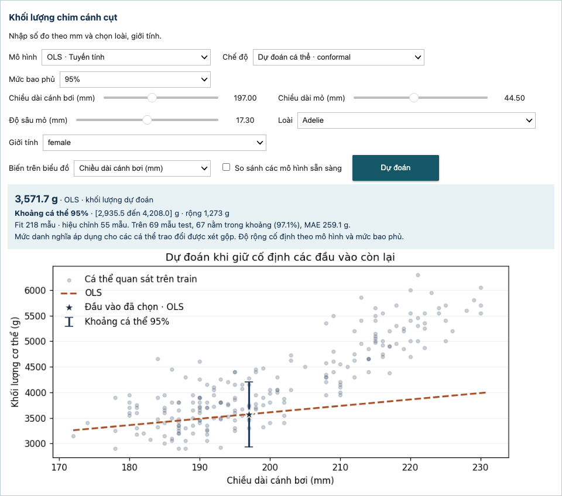

# Palmer Penguins · nghiệm thu thiết kế với bốn mô hình

Ảnh, thời gian và điểm số trong tài liệu này được ghi ở bản thiết kế `ca118f9`. Bản tích hợp nhóm đã thêm M4 Huber vào benchmark, conformal và giao diện. [Nghiệm thu năm mô hình](handoff.md)

Mục 5 của notebook và bản trình diễn localhost cho cùng kết quả. Với OLS mặc định, dự đoán là **3.571,7 g**, khoảng cá thể 95% từ **2.935,5 đến 4.208,0 g**. Có **67/69** khối lượng thật trong dải ở tập test. Có thể chọn một ID, đối chiếu với bảng rồi tải kết quả của cá thể đang khảo sát. [Hướng dẫn chạy](../README.md#trình-diễn-độc-lập) · [Kịch bản hai phút](section-3-4-application.md#demo-hai-phút) · [Số đo và kết quả kiểm tra máy đọc được](ui-checks.json)

| Trước · `7497080` | Sau · cùng dữ liệu, mô hình và mức bao phủ |
| --- | --- |
|  |  |

Ở bản trước, hình ba loài tĩnh chiếm ít chỗ nhưng chưa cho thấy cách lấy số đo. Dải kết quả đầy đủ lặp lại ở các trang phân tích. Trên điện thoại, tên mô hình và nút khôi phục phải chia sẻ những ô hẹp. Khi đọc một dấu × trên tập test, người xem phải dò thủ công từ trục sang bảng. Bản mới ghép biểu mẫu với hai hình chiếu của chim trên laptop, dành một dòng cho ngữ cảnh ở các trang phân tích và nối từng dấu với đúng hàng dữ liệu. Bản trình diễn mở trực tiếp vào ứng dụng. [Audit tại mốc trước](https://github.com/phuctran33/regression-lab01/blob/7497080751f42cc431cc39c0605c72564823a32c/report/ui-audit.md) · [Hình laptop](figures/application/viewport-1366.png) · [Hình điện thoại](figures/prediction-narrow.png)

## Nghiệm thu 28 yêu cầu

| Yêu cầu | Bằng chứng | Trạng thái | Giới hạn |
| --- | --- | --- | --- |
| 1. Nhận diện thị giác | Phong cảnh, typography tên loài, giấy màu ngà, số liệu trên nền xanh và trục gram. [Toàn cảnh](figures/prediction-dashboard.png) | PASS về triển khai | Đánh giá thẩm mỹ có tính chủ quan. |
| 2. Minh họa giải phẫu | Hình toàn thân và mỏ phóng lớn, ba đường đo, hướng đo và đơn vị. [Sơ đồ và nguồn](section-3-4-application.md#sơ-đồ-đo-và-cách-đọc-một-điểm) | PASS | Sơ đồ giáo dục, tỷ lệ minh họa quy ước. |
| 3. Thay đổi theo loài | Chọn lần lượt ba loài. Tên khoa học, mảng đầu, mắt, cằm và mỏ đổi theo lựa chọn. [Bản vẽ](../source/ui/anatomy.svg) · [Gentoo](figures/application/anatomy.png) | PASS | Ba loài trong dữ liệu Palmer. |
| 4. Liên kết số đo với hình | Focus, hover, phím Enter và tap. Chọn đường đo trả focus về đúng ô và cập nhật giá trị mm. [Luồng tương tác](../tests/browser_prediction.py) | PASS | Chạm mô phỏng bằng Chromium. |
| 5. Typography | Khối lượng dùng chữ số tabular và đơn vị nhỏ. Định dạng tiếng Việt áp dụng cho tooltip và cận. [Kết quả](figures/prediction-dashboard.png) | PASS | Font chữ điều khiển phụ thuộc hệ điều hành. |
| 6. Bố cục và khoảng cách | Số đo cạnh nút tính, kết quả cạnh biểu mẫu, hình khoa học dùng hết chiều ngang phía dưới. [1280 × 720](figures/application/viewport-1280.png) | PASS | Phần hình và bảng chi tiết có thể cần cuộn. |
| 7. Bố cục thích ứng theo nhiệm vụ | Dự đoán có sơ đồ đo. Trang phân tích dùng tóm tắt một dòng, có lối quay lại. [So sánh](figures/application/interval-comparison.png) · [Phương pháp](figures/application/method.png) | PASS | Bốn khu vực dùng chung trạng thái. |
| 8. Luồng laptop | Tại bốn khổ desktop thật, nút tính và khối lượng cùng hiện sau khi đưa đầu widget vào vùng nhìn. [1366 × 768](figures/application/viewport-1366.png) · [1440 × 900](figures/application/viewport-1440.png) · [1920 × 1080](figures/application/viewport-1920.png) | PASS | Đo trong viewport nội dung, có thanh công cụ JupyterLab. |
| 9. Trực quan hóa khoa học | Chín hình, hai cách dàn trục, mô tả và bảng. [Histogram](figures/application/residual-histogram.png) · [Boxplot](figures/prediction-errors.png) · [Thực tế và dự đoán](figures/application/actual-predicted.png) | PASS | Độ phân giải theo hai canvas Matplotlib. |
| 10. Tooltip theo dữ liệu | M2, 90%, ID 119 Adelie có thực tế 3.325,0 g và dự đoán 3.953,4 g. Trỏ, chạm hoặc chọn qua danh sách đều truy xuất cùng bản ghi. [Điểm đang chọn](figures/application/point-inspector.png) | PASS | Với các điểm trùng vị trí, dùng danh sách để chọn đúng ID. |
| 11. Dấu chọn | Vòng đánh dấu theo điểm, kiểu nét theo mô hình, × cho cá thể ngoài dải, hạng hiệu chỉnh có ký hiệu riêng. [Dải test](figures/application/test-plot.png) · [Phân vị](figures/application/method.png) | PASS | Hình nhấn đúng predictor và protocol hiện hành. |
| 12. Phóng to | Hộp thoại native, hình lớn hơn trên laptop, Tab ở trong hộp, Esc đóng, giữ ID đang xem và khôi phục tiêu điểm. [Hình mở rộng](figures/application/expanded.png) | PASS | Thao tác thay đổi vùng hiển thị. |
| 13. Trợ giúp tại chỗ | Kết quả giải thích hai cận, mức mục tiêu, tỷ lệ test và MAE. Mỗi hình có trợ giúp theo ngữ cảnh. Bảng tra giữ đủ 18 thuật ngữ. [Phương pháp](figures/application/method.png) | PASS | Nội dung bằng tiếng Việt. |
| 14. Trình diễn độc lập | Voilà chạy cùng cell và widget, chặn mọi HTTP ngoài localhost trong bài thử. [Màn hình trình diễn](figures/application/presentation.png) | PASS | Mỗi phiên cần một kernel trong môi trường Python cục bộ đã cài. |
| 15. Toàn màn hình | Vào/thoát fullscreen khi trình duyệt hỗ trợ và lấy lại focus. Chế độ trình diễn luôn có thể chạy một lệnh. [Runner](../tests/browser_prediction.py) | PASS | Quyền fullscreen do trình duyệt quyết định. |
| 16. Xuất kết quả | Tải và đọc lại CSV để đối chiếu đầu vào, protocol, predictor, cận, MAE và coverage. Sau khi sửa số đo, đường tải biến mất. [Kiểm tra tám tổ hợp mô hình và protocol](../tests/test_prediction_evidence.py) | PASS | Một hàng/lần dự đoán. Khoảng và CI chỉ xuất khi có cơ sở. |
| 17. Phản hồi thao tác | Trạng thái đang tính, chờ tính, lỗi và khôi phục. Đã thử tooltip qua focus và pointer, cùng tùy chọn giảm chuyển động. [Trạng thái lỗi](figures/application/input-error.png) | PASS | Độ trễ của kernel phụ thuộc máy. |
| 18. Các lỗi trên mobile | Nút khôi phục xuống dòng riêng, tên mô hình có hàng đủ rộng và liên kết đọc kết quả dùng chữ đậm trên nền sáng. [Điện thoại](figures/prediction-narrow.png) | PASS | Bảng dài có vùng cuộn riêng. |
| 19. Khả năng tiếp cận | Kiểm axe, bàn phím, tương phản, zoom và lời đọc Orca. [Kết quả chi tiết](ui-checks.json) | PASS với các phép đã chạy | VoiceOver và NVDA **NOT VERIFIED**. Chưa có chứng nhận WCAG. |
| 20. Responsive | Tám khổ từ 320 đến 1920 px được lặp trên các hình. Zoom trình duyệt thật 200% cho 683 CSS px từ 1366 px. [Runner](../tests/browser_prediction.py) | PASS | Điện thoại vật lý **NOT VERIFIED**. |
| 21. Hiệu năng | Đo kernel mới và thao tác lặp cho cùng phiên bản Chromium. [Kết quả trước và sau](#hiệu-năng) | PASS về phép đo | Mẫu cục bộ, ba lượt cho mỗi thao tác, có nêu chi phí khởi tạo. |
| 22. Trình duyệt | Chromium và Firefox với notebook, WebKit với bản trình diễn. [Kết quả theo engine](ui-checks.json) | PASS cho ba engine | Safari bản thương mại **NOT VERIFIED**. |
| 23. Đầy đủ chức năng | Bốn mô hình, hai protocol, năm đầu vào, năm preset, hai mức bao phủ, reset, chín đồ thị và glossary. [Runner](../tests/browser_prediction.py) | PASS | M4 chờ Phúc. |
| 24. Tính đúng đắn thống kê | Bảng/điểm test đối chiếu predictor, hạng 51/55 và 54/55 cho hai mức. Ba CI bootstrap chênh lệch MAE chứa 0. [Số liệu](comparison.json) | PASS | Coverage biên phụ thuộc giả thiết trao đổi được. |
| 25. Tái lập | 34 unit test, notebook kernel sạch, JSON và ba PNG evaluation khớp từng byte. [Bàn giao](handoff.md) | PASS trong phạm vi bốn mô hình | Kiểm tra đủ năm mô hình còn báo hai mục M4. |
| 26. Trải nghiệm demo | Mở app bằng một lệnh rồi đi từ cá thể đến 69 ID, thay mức, xem phương pháp, xuất và khôi phục. [Demo hai phút](section-3-4-application.md#demo-hai-phút) | PASS cho luồng thực thi | Thời lượng là gợi ý cho người trình bày. |
| 27. Rubric Application | Nhập đặc trưng, dự đoán, đọc hình và diễn giải cho cả bốn mô hình. [Đối chiếu đề](handoff.md) | PASS về đối chiếu | Điểm chính thức **NOT VERIFIED**. |
| 28. Lời dặn giảng viên | Có nhận xét, histogram, boxplot, mức bất định, kiểm đếm coverage và demo. [Đối chiếu từ góc nhìn người chấm](#trải-nghiệm-của-người-chấm) | PASS về các tác vụ đã thử | Phản hồi trực tiếp của giảng viên **NOT VERIFIED**. |

## Accessibility và tương thích

Trong notebook, Chromium 159 và Firefox 159 chạy qua mặc định, ô sai, so sánh khoảng, dải test, hình mở rộng, coverage–width, phương pháp, benchmark, thực tế–dự đoán, sai số theo loài, mobile và giao diện tối. WebKit 18.4 chạy cùng luồng với Voilà, nguồn ngoài localhost bị chặn. Axe-core 4.14.1 kiểm tra A/AA được hỗ trợ qua WCAG 2.2 trên vùng ứng dụng. Số vi phạm tự động là 0. Với WebKit, axe yêu cầu kiểm tra thủ công tương phản ở một số select, chữ SVG và tiêu đề phủ ảnh. [Kết quả từng trạng thái](ui-checks.json)

Theo độ chói sRGB, chữ chính trên nền trắng đạt 12,69∶1, nút chính 7,79∶1, hai trạng thái chữ SVG trên nền giấy đạt 6,20 và 6,30∶1. Nút đọc kết quả trên nền biểu mẫu đạt 7,49∶1, viền điều khiển trên nền trắng đạt 3,64∶1. Đo ảnh WebKit ở 320, 390, 768 và 1280 px bằng cách so nền ở cùng vị trí trước và sau khi ẩn chữ. Tỷ lệ thấp nhất của chữ phần đầu trang là 4,96∶1 ở 320 px. Chữ của select đang bật đạt 12,69∶1. Đường đo đang chọn còn dày hơn và các trường hợp ngoài khoảng còn có dấu ×. Người dùng bàn phím có thể duyệt từng điểm, mở số liệu và đóng hình phóng lớn bằng Esc. Bài thử dùng giảm chuyển động, forced colors, JupyterLab Light/Dark và 200% zoom thực của Chromium. [Màu và kiểu tương tác](../source/ui/panel.css)

Orca 43.1 trên Debian, AT-SPI và Chromium 156 đã đọc ô chiều dài cánh bơi, hướng dẫn sau khi sửa, trạng thái đang tính, dự đoán **3.573,0 g** cùng hai cận **2.936,7–4.209,3 g** sau khi tăng từ 197,0 lên 197,1 mm. Khi đổi điểm trong danh sách, Orca đọc biến, giá trị và khối lượng dự đoán của điểm mới. Đã thu tín hiệu tiếng nói qua PulseAudio vào thiết bị ảo. Đây là phép kiểm nội dung lời đọc và điều hướng. Phiên macOS chưa cấp quyền Accessibility cho tiến trình thử VoiceOver. Môi trường thử không có Windows/NVDA. SafariDriver trả HTTP 500 do tùy chọn Allow remote automation đang tắt. Chất lượng phát âm tiếng Việt của từng giọng chưa được người nghe đánh giá. [Biên bản thực chạy](ui-checks.json)

## Hiệu năng

Mac Apple M1, 8 GiB RAM, macOS 14.6.1, Python 3.12.15, JupyterLab 4.5.6, Chromium 159.0.8154.6, viewport 1366 × 768. Mỗi bản mở một browser context và kernel mới trên server đã chạy với cache hệ điều hành ấm. Ba lượt thao tác sau khi có kết quả. Số dưới đây là trung vị ở các hàng có ba lượt. [Runner benchmark](../tests/benchmark_prediction.py) · [Mẫu thời gian gốc](ui-checks.json)

| Thao tác | Trước · `7497080` | Sau |
| --- | ---: | ---: |
| Khởi tạo PredictionApp từ bốn mô hình đã fit, trước lần vẽ đầu (một tiến trình riêng mỗi bản) | 9,428 s | 9,722 s |
| Vẽ kết quả đầu sau khởi tạo trong Python | 119 ms | 113 ms |
| Mở notebook tới khi có thể dự đoán | 15,492 s | 13,842 s |
| Từ Run All tới kết quả sử dụng được | 12,501 s | 11,388 s |
| Dự đoán lại cùng số đo | 188 ms | 37 ms |
| Đổi mô hình và dự đoán | 224 ms | 108 ms |
| Mở So sánh mô hình | 88 ms | 90 ms |
| Chuyển sang hình hiệu chỉnh | 37 ms | 34 ms |
| Khôi phục toàn bộ mặc định | 121 ms | 45 ms |
| Sự kiện trỏ trên một điểm đến khung hình kế tiếp | Chưa có tooltip | 12,2 ms |

Lần chạy đối chứng trước chỉnh sửa cho 17,322 s từ mở notebook đến tương tác. Phép đo so cặp sau đó chạy hai bản liền nhau với cùng runner. Thời gian riêng lẻ phụ thuộc tải máy và cache. Khi đưa bộ số đo mới vào cache lần đầu, lần dự đoán đầu của bản mới mất 194 ms. Bộ nhớ giữ tối đa sáu hình xu hướng gần nhất. Chuyển tab hoặc thay đầu vào dùng lại các predictor đã fit. [Test chặn fit ngoài ý muốn](../tests/test_prediction_evidence.py)

Hai ảnh đồ thị xu hướng mặc định vẫn là 44.921 và 39.666 byte. Bản mới thêm khoảng 40.129 byte JSON nhãn và tọa độ cho chính hình đó. Sơ đồ SVG khoảng 4 kB thay cho PNG 113.058 byte từng nhúng vào widget. Ảnh phong cảnh 58.856 byte và font cục bộ 27.692 byte. Biên bản ghi số byte nguồn của từng tài nguyên. Trình duyệt còn nhận dữ liệu widget qua kết nối kernel. [Dữ liệu đo](ui-checks.json)

## Scorecard thiết kế

Điểm trung bình trước và sau lần lượt là **92,7/100** và **96,4/100**. Mỗi tiêu chí có trọng số bằng nhau. Hai cột dùng cùng phạm vi của lần này, kể cả các chức năng chưa có ở mốc trước. Các nhận xét thẩm mỹ là tự đánh giá. Các số đo và phép thử nằm ở phần nghiệm thu phía trên.

| Tiêu chí | Trước | Sau | Căn cứ |
| --- | ---: | ---: | --- |
| Thẩm mỹ | 95 | 97 | Số chính, tranh vùng cực và trang số đo tạo ba điểm nhấn. Đồ thị giữ nền sáng. |
| Chỉ đạo mỹ thuật | 95 | 97 | Từ phong cảnh đến bản vẽ đo, hình ảnh phục vụ cùng một hành trình quan sát. |
| Nhận diện | 96 | 97 | Ba loài có dấu hiệu hình thái và tên khoa học ngay cạnh kết quả. |
| Typography | 94 | 97 | Chữ số tabular thoáng hơn, gram nhỏ hơn và hai cận vẫn đọc được trên điện thoại. |
| Bố cục | 94 | 97 | Biểu mẫu và kết quả đứng cạnh nhau trên laptop. Màn phân tích dành chiều rộng cho hình. |
| Khoảng cách | 93 | 95 | Số đo gần nút tính. Biểu mẫu một cột vẫn dài trên màn hình nhỏ. |
| Hài hòa màu | 95 | 96 | Xanh đậm cho kết quả, nền giấy cho giải phẫu và màu đồng cho phép đo đang chọn. |
| Thứ bậc thị giác | 95 | 97 | Sau khi chọn tab phân tích, tên biểu đồ và dữ liệu trở thành nội dung chính. |
| Minh họa | 81 | 96 | Ảnh tham chiếu tĩnh được thay bằng sơ đồ ba phép đo, đối chiếu hình thái với tài liệu. |
| Ký hiệu | 90 | 95 | Dấu sao, dấu ×, thoi, kiểu nét và vòng tròn chọn đều có ý nghĩa. Dấu gần nhau cần danh sách. |
| Điều hướng | 94 | 96 | Bốn mục chung trạng thái, thêm đường quay về ô nhập và focus trả lại sau khi xem hình. |
| Kiến trúc thông tin | 96 | 97 | Dự đoán, so sánh, kiểm chứng và phương pháp trả lời bốn câu hỏi riêng. |
| Nhất quán | 95 | 97 | Cùng một bộ điều khiển và cùng renderer khi mở notebook hoặc trình diễn. |
| Dễ sử dụng | 93 | 96 | Preset, CSV, nút tính cạnh số đo và trợ giúp ở đúng kết quả. Chưa có nghiên cứu người dùng. |
| Tương tác | 88 | 97 | Có thể chọn một ID bằng trỏ, chạm hoặc phím và đối chiếu với bảng. |
| Phản hồi thao tác | 91 | 95 | Đánh dấu theo tiêu điểm, báo trường sai, giữ lựa chọn khi đóng hình và tôn trọng giảm chuyển động. |
| Trực quan hóa khoa học | 96 | 98 | Chín hình có tọa độ lấy từ chính hai canvas, đơn vị, mô tả và bảng. |
| Truyền đạt thống kê | 96 | 98 | Tách mục tiêu, tỷ lệ test và MAE. Xuất cả protocol, cỡ tập fit và hai cận theo gram. |
| Khả năng tiếp cận | 92 | 94 | Đã thử thêm dialog native, bàn phím, WebKit, cảm ứng mô phỏng và zoom. Còn giới hạn thiết bị. |
| Hiển thị đáp ứng | 93 | 96 | Tám khổ và ảnh compact riêng. Bảng nhiều cột vẫn cần cuộn cục bộ ở khổ nhỏ. |
| Hiệu năng | 90 | 94 | Dự đoán lặp và reset nhanh hơn. Khởi tạo bốn predictor vẫn chiếm phần lớn thời gian. |
| Đầy đủ chức năng | 89 | 98 | Bốn mô hình, chín hình, xuất đúng predictor và trình diễn ngoại tuyến. |
| Mức hoàn thiện | 94 | 96 | Đã sửa vùng chạm SVG, tên điều khiển điểm, nút bị cắt và xuất dữ liệu cũ. |
| Trình diễn | 87 | 98 | Chạy một lệnh, mở toàn màn hình và phóng to dữ liệu mà vẫn giữ cùng mô hình. |
| Bao phủ rubric | 96 | 97 | Có thể thực hiện và tái lập đầu vào, dự đoán, khoảng và phần diễn giải. |
| Trải nghiệm giảng viên | 93 | 96 | Có lộ trình hai phút từ phép đo đến ID ngoài khoảng. Chưa có phản hồi trực tiếp. |

## Trải nghiệm của người chấm

| Câu hỏi của người lần đầu mở ứng dụng | Thao tác kiểm chứng |
| --- | --- |
| Bài toán là gì và năm biến có ý nghĩa gì? | Đọc câu mô tả đầu trang, chọn loài và giới tính, rồi chuyển giữa ba đường đo có nhãn và đơn vị mm. |
| Có thể tạo dự đoán và hiểu khoảng không? | Chọn một preset, bấm **Dự đoán**, đọc điểm và hai cận trên cùng thước gram. Mở **Cách đọc kết quả** để xem cỡ tập và ý nghĩa mức bao phủ. |
| Có cơ sở tin vào kết quả đến đâu? | Đối chiếu MAE trên test, coverage k/n, độ rộng và cảnh báo miền train của loài. Mục Phương pháp nêu giả định trao đổi được. |
| Có thể tự kiểm lại coverage bằng dữ liệu thật không? | Với M2 ở 90%, mở bảng 69 hàng, chọn một ID ngoài khoảng trên đồ thị rồi tìm khối lượng thật so với hai cận. Đếm được 62 trong và 7 ngoài. |
| So sánh mô hình và đọc nhận xét thế nào? | So bốn khoảng trên một trục. Chuyển Benchmark để xem chênh lệch MAE, CV và CI bootstrap. Giao diện nêu cả độ lớn và giới hạn kết luận. |
| Histogram, boxplot và các trục có đúng nghĩa không? | Histogram dùng phần dư có dấu. Boxplot dùng trị tuyệt đối theo loài. Mở bảng tần số hoặc tứ phân vị. Hình thực tế–dự đoán có đường y = x. |
| Thiết kế và trình diễn ra sao? | Chạy một lệnh, mở toàn màn hình, phóng to hình, quay về ô số, tải CSV và reset. Điểm hình thức là nhận định ở scorecard. Giảng viên chấm theo rubric chính thức. |

## Tái chạy và nguồn thiết kế

Từ môi trường đã cài requirements, chạy `python -m source.present` hoặc mở một bản sao notebook bằng `python -m jupyterlab --expose-app-in-browser`. Kiểm thử trình duyệt cần cài Playwright, browser binary tương thích và một bản axe-core cục bộ trong môi trường QA. URL notebook phải trỏ đúng bản sao vì runner thực thi tất cả cell. Mỗi engine dùng phiên sạch. [Mã kiểm thử](../tests/browser_prediction.py)

```bash
python tests/browser_prediction.py "<URL notebook>" --axe /path/to/axe.min.js --touch --evidence-dir /tmp/palmer-shots
python tests/browser_prediction.py "<URL notebook khác>" --axe /path/to/axe.min.js --browser firefox
python tests/browser_prediction.py http://127.0.0.1:8866 --presentation --browser webkit --axe /path/to/axe.min.js
python tests/benchmark_prediction.py "<URL notebook mới>"
```

Hướng mỹ thuật lấy cảm hứng từ cách tài liệu bảo tàng kết nối hình loài với dữ kiện. Sơ đồ đo là vector thiết kế riêng. Vòng dữ liệu dùng nguyên tắc chọn dấu gần con trỏ trong tọa độ hiển thị. Danh sách và bảng cho phép chọn chính xác khi xem bằng bàn phím. Hộp thoại dùng hành vi focus và Escape của trình duyệt. Bộ chữ Bricolage Grotesque cục bộ giữ giấy phép SIL OFL. [Smithsonian Ocean](https://ocean.si.edu/ocean-life/seabirds/penguins) · [Palmer Penguins](https://allisonhorst.github.io/palmerpenguins/) · [Observable Plot](https://observablehq.com/plot/interactions/pointer) · [WAI dialog](https://www.w3.org/WAI/ARIA/apg/patterns/dialog-modal/) · [Giấy phép font](../source/ui/fonts/OFL.txt) · [Voilà](https://voila.readthedocs.io/en/stable/using.html)

Đã dùng **Frontend Design** (Anthropic), **UI/UX Pro Max** và **Design System**. Frontend Design đã được tải và cài từ commit chính thức `e4bb5d9` trong đợt trước. Hai skill còn lại đã có trong môi trường. Lần này dùng lại ba skill, Playwright, axe-core và Orca. [Frontend Design](https://github.com/anthropics/skills/tree/e4bb5d960d87126ff3b3a8af1a104b7db67560ba/skills/frontend-design) · [UI/UX Pro Max](https://github.com/nextlevelbuilder/ui-ux-pro-max-skill) · [Danh mục OpenAI Skills](https://github.com/openai/skills)

Khi nhận M4, kiểm estimator thật của Phúc, quy trình chọn cấu hình chỉ trên train, benchmark trên 69 ID, nested CV và bootstrap theo cặp. Fit conformal trên 218 proper train, hiệu chỉnh riêng trên 55 mẫu và kiểm coverage ở 90%/95%. Sau đó mới đưa M4 vào đúng chế độ, tái tạo metric, chạy lại notebook, các luồng UI và xuất CSV. [Checklist tích hợp](handoff.md#lần-tích-hợp-tiếp-theo)
