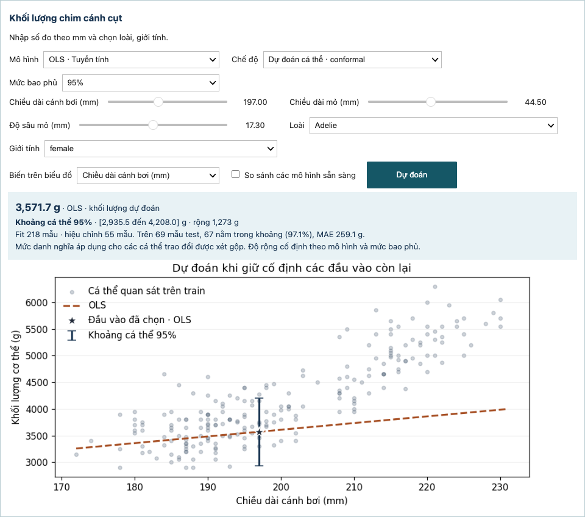

# Nghiệm thu giao diện dự đoán ở mục 5

Hai ảnh dưới đây chụp trực tiếp trong JupyterLab ở cùng đầu vào mặc định, cùng chế độ conformal và cùng OLS. Cả hai lần đều cho **3.571,7 g**, với khoảng cá thể 95% từ **2.935,5 đến 4.208,0 g**. Trên tập test, 67/69 cá thể nằm trong khoảng của mình. Đây là tần suất thực nghiệm trên tập test. Mức 95% là mục tiêu bao phủ biên của quy trình.

| Trước, commit `a758887` | Sau, bản bàn giao |
| --- | --- |
|  |  |

Ở màn hình hẹp, các phần xếp dọc theo thứ tự nhập liệu, dự đoán rồi đọc hình. Mỗi hình có phần số liệu mở được bằng bàn phím. Trong ví dụ M3, boxplot và bảng dùng 35 Adelie, 11 Chinstrap và 23 Gentoo. Trung vị sai số tuyệt đối lần lượt là 277,9 g, 207,3 g và 190,9 g. Số mẫu mỗi loài giúp người đọc cân nhắc khi so sánh. [Ảnh màn hình hẹp](figures/prediction-narrow.png) · [Boxplot và bảng](figures/prediction-errors.png)

## Điểm tự đánh giá

Điểm là nhận định thiết kế trên thang 100. Dưới 70 ứng với thiếu chức năng hoặc có rào cản đáng kể, 70–84 ứng với luồng chính dùng được nhưng còn khó đọc hoặc thao tác. Mức 85–94 cần có bằng chứng ở nhiều trạng thái, 95–99 cần thêm đối chiếu số liệu hoặc kiểm thử xuyên suốt. Điểm tối đa đòi hỏi cả kiểm chứng với người dùng mục tiêu. Hai cột điểm áp dụng cùng thang.

| Tiêu chí | Trước | Sau | Căn cứ |
| --- | ---: | ---: | --- |
| Thẩm mỹ | 74 | 93 | Đánh giá thị giác từ hai ảnh. Minh họa đúng bộ dữ liệu, tiêu đề serif và khoảng trắng phân biệt vùng nhập với kết quả. |
| Dễ sử dụng | 79 | 94 | Nhập chính xác được từng số đo, biết ngay trường nào sai và khi nào cần dự đoán lại. |
| Khả năng tiếp cận | 64 | 92 | Đã xử lý bốn phần tử bị axe đánh dấu. Có tên cho thanh trượt, mô tả hình, bảng số liệu, vùng thông báo và luồng bàn phím đã thử. Còn thiếu kiểm thử bằng trình đọc màn hình. |
| Bố cục thích ứng | 76 | 91 | Co giãn theo chiều rộng ô notebook. Đã mở bảng năm cột trên cửa sổ 320 px. Khi Jupyter chỉ còn khoảng 200 px cho output, chữ trong hình nhỏ và phải cuộn dọc. |
| Trực quan hóa dữ liệu | 79 | 95 | Dải khoảng có hai cận. Đường xu hướng, histogram phần dư và boxplot sai số có đơn vị, diễn giải và bảng. Kiểm thử đối chiếu trực tiếp phần dư và tứ phân vị. |
| Đầy đủ chức năng trong phạm vi bốn mô hình | 87 | 96 | Chạy cả hai chế độ, đổi mức bao phủ, so sánh mô hình, thử đầu vào trống, ngoài miền và phục hồi. |
| Nhất quán thiết kế | 76 | 93 | Đồng bộ cách viết số đo, gram, màu hành động, kiểu nhãn và thứ tự đọc. Điều khiển trong khung Jupyter phụ thuộc trình duyệt. |
| Đáp ứng lời dặn giảng viên | 84 | 95 | Một luồng nhập và dự đoán, kết quả kèm độ bất định, số quan sát, nhận xét và hình tương tác. Việc chấm theo rubric chính thức thuộc giảng viên. |

## Bằng chứng kiểm thử

- Chạy notebook từ kernel mới trong JupyterLab 4.5.6. Playwright điều khiển Chrome 158 và nạp axe-core 4.14.1 từ tệp cục bộ. Phạm vi quét là `.penguin-panel`, với các tag `wcag2a`, `wcag2aa`, `wcag21a`, `wcag21aa` và `wcag22aa`.
- Bản trước có ba thanh trượt thiếu tên truy cập (`aria-input-field-name`) và hình xu hướng thiếu mô tả (`image-alt`). Sau lần chỉnh giao diện đầu, việc đọc cây accessibility còn phát hiện ID trùng ở các ô số. Mỗi lần render hiện tạo ID riêng và liên kết cả nhãn lẫn mô tả lỗi đúng trường.
- Kiểm tra luồng chính với OLS, M1, M2, M3 ở chế độ benchmark và conformal. Đổi 95% sang 90% giữ nguyên dự đoán điểm và thay hai cận. OLS benchmark có CI cho trung bình và PI cho cá thể. Thay loài, giới tính, số đo, biến trên hình và bật/tắt so sánh đều được thử. Histogram có tám khoảng với tổng tần số 69. Tần số theo ba loài trong bảng boxplot cũng cộng thành 69.
- Lượt rà soát riêng mở trình duyệt và kernel mới, lần lượt dùng Tab tới thanh trượt, phím mũi tên để đổi số và Enter trên nút dự đoán. Thử để trống ô số, khôi phục giá trị, mở bảng ở cửa sổ 320–1440 px, đổi giao diện Jupyter sang tối và bật chế độ màu tương phản bắt buộc của Chrome. Đã rà ảnh desktop, ảnh hẹp, thứ tự đọc, dấu focus và nút bị khóa khi dữ liệu sai.
- Các lần quét sau chỉnh sửa ghi nhận **0 vi phạm** trong các trạng thái mặc định, nhập sai, histogram mở bảng, boxplot mở bảng, benchmark OLS, giao diện tối và màn hình hẹp. Đây là kiểm thử theo phạm vi và trình duyệt nêu trên. VoiceOver, NVDA, Safari, thiết bị cảm ứng thật và đánh giá trực tiếp với giảng viên vẫn chưa được kiểm chứng.

| Trạng thái | Quy tắc qua | Quy tắc vi phạm | Phần tử vi phạm | Quy tắc cần xem thêm (incomplete) |
| --- | ---: | ---: | ---: | ---: |
| Trước · mặc định | 16 | 2 | 4 | 0 |
| Sau · mặc định | 21 | 0 | 0 | 0 |
| Ô số không hợp lệ | 20 | 0 | 0 | 0 |
| Histogram, mở bảng | 23 | 0 | 0 | 0 |
| Boxplot, mở bảng | 23 | 0 | 0 | 0 |
| Benchmark OLS | 21 | 0 | 0 | 0 |
| Cửa sổ 480 px | 21 | 0 | 0 | 0 |
| JupyterLab Dark | 21 | 0 | 0 | 0 |
| Boxplot mở bảng, 480 px | 23 | 0 | 0 | 0 |

Khi chuyển nhanh qua lại giữa hai theme, Chrome đôi lúc ghi lỗi DOM của màn hình chờ JupyterLab 4.5.6. Lỗi cũng tái hiện ở workspace trống khi JupyterLab gỡ phần tử `#jupyterlab-splash`. Hai lượt chạy nghiệm thu cuối của Application hoàn thành toàn bộ thao tác và không ghi nhận ngoại lệ trang.

Để lặp lại, cài requirements, chạy toàn bộ notebook và cuộn đến mục 5. Trong axe DevTools có thể giới hạn vùng quét vào `.penguin-panel`. Với bản phân phối axe-core nạp cục bộ trong DevTools, câu lệnh tương đương là

```js
await axe.run('.penguin-panel', {
  runOnly: {type: 'tag', values: ['wcag2a', 'wcag2aa', 'wcag21a', 'wcag21aa', 'wcag22aa']}
})
```

## Thiết kế và tái lập

UI/UX Pro Max hỗ trợ chọn nhãn, dấu focus, tương phản và bố cục thích ứng. Frontend Design của Anthropic được dùng để phân cấp chữ và chọn phong cách sổ tay quan sát. Minh họa ba loài được lưu cục bộ và ghi công cạnh hình. Playwright và axe chỉ dùng khi nghiệm thu. Widget dùng anywidget cùng mã JavaScript/CSS trong repository. [UI/UX Pro Max](https://github.com/nextlevelbuilder/ui-ux-pro-max-skill) · [Frontend Design](https://github.com/anthropics/skills/tree/e4bb5d960d87126ff3b3a8af1a104b7db67560ba/skills/frontend-design) · [Artwork by @allison_horst](https://allisonhorst.github.io/palmerpenguins/articles/art.html)

Các lệnh `python -m unittest discover -s tests -v`, `python -m source.evaluation`, `python -m source.analysis.comparison` và `python -m source.check_week2 --notebook` kiểm tra phần Python. JSON benchmark/nested CV/conformal cùng ba hình của evaluation tái tạo khớp từng byte với bản đã bàn giao. Hai mục còn thiếu trong bộ kiểm tra chung là cấu hình M4 và đủ năm mô hình thật. [Hướng dẫn chạy và trạng thái bàn giao](handoff.md)
