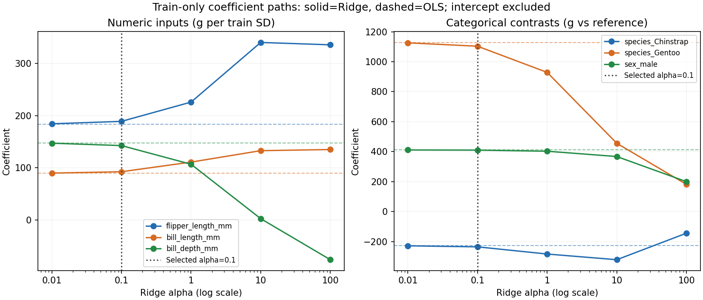
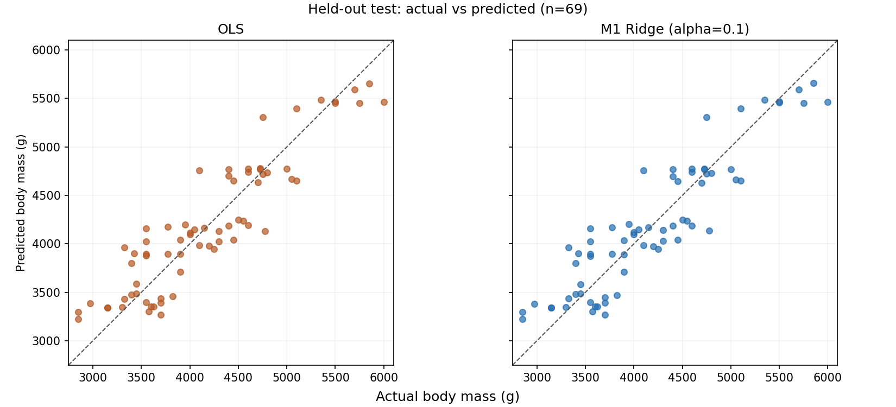
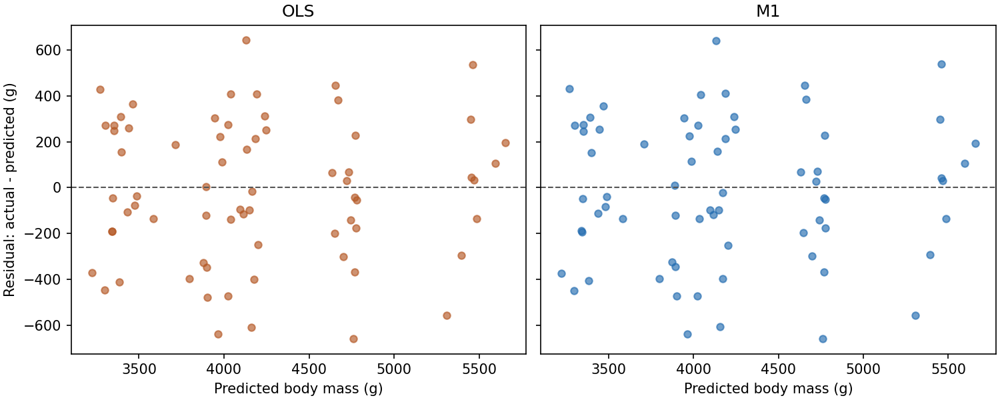
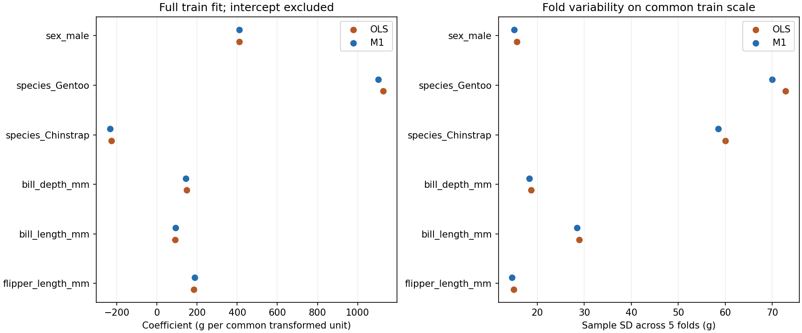

# M1 Ridge · Bàn giao tuần 2 (23–29/11/2026)

**Phụ trách:** Tiết Trọng Khiêm · 24127058. 

## 3.1. Lựa chọn và xác định bài toán

### Động cơ chọn đề tài

Nhóm chọn hồi quy khối lượng chim cánh cụt trên bộ Palmer Penguins vì biến đích có đơn vị rõ ràng (gram),
đầu vào gồm cả số đo và biến phân loại, có dữ liệu thiếu để thực hành một pipeline hoàn chỉnh.
Bài toán cho phép so sánh các cách biểu diễn quan hệ và điều chuẩn trong cùng thiết kế đánh giá, đồng thời
kiểm tra liệu độ phức tạp bổ sung có làm giảm lỗi dự đoán thực tế hay không. Đây là mục đích học tập và
minh họa dự đoán; không suy từ kết quả mô hình sang kết luận nhân quả hay ứng dụng sinh học ngoài dữ liệu.

### Mục tiêu và đầu vào/đầu ra

Mục tiêu là học một hàm dự đoán `body_mass_g` theo gram từ năm đầu vào quan sát được.
Mô hình được fit bằng train và đánh giá bằng sai số trên các cá thể test giữ riêng.

| Vai trò | Biến | Ý nghĩa và đơn vị |
| --- | --- | --- |
| Đích | body_mass_g | Khối lượng cơ thể; đại lượng liên tục, gram |
| Đầu vào | flipper_length_mm | Chiều dài cánh bơi; mm |
| Đầu vào | bill_length_mm | Chiều dài mỏ; mm |
| Đầu vào | bill_depth_mm | Độ sâu mỏ; mm |
| Đầu vào | species | Loài; biến phân loại |
| Đầu vào | sex | Giới tính; biến phân loại |

Các số đo mô tả hình thái; loài và giới tính cho phép mô hình biểu diễn khác biệt có điều kiện giữa các nhóm.
Việc dùng những biến này là lựa chọn thiết kế cần được đánh giá từ sai số/hệ số, không phải khẳng định trước về tác động của chúng.
Đảo/năm nằm ngoài bộ đầu vào chung đã chốt.

### Dữ liệu và phạm vi kết luận

CSV có 344 dòng, 8 cột. Loại 2 dòng thiếu đích rồi chia 273 train / 69 test với seed 42.
Giữ nguyên năm FEATURES của nhóm để các mô hình so sánh trên cùng cá thể.
Nếu không biết loài/giới tính, không suy ra từ khối lượng cần dự đoán; mode imputation học từ train chỉ là
quy tắc xử lý thiếu, không khôi phục thông tin thật. Sai số nhóm thiếu giới tính được trình bày riêng.
Kết quả giới hạn ở bộ mẫu và cách chia hiện tại; không tự chứng minh khả năng tổng quát sang loài hay quần thể mới.

## 3.2. Ridge và cách chọn alpha

Ridge dùng mục tiêu RSS + alpha × tổng bình phương hệ số, không phạt intercept.
Theo ISLP Chương 6, điều chuẩn chấp nhận đánh đổi bias–variance; không suy ra rằng mọi alpha đều tốt hơn OLS.
Chọn Ridge vì các số đo và loài có thể mang thông tin trùng lặp: phạt L2 giúp hạn chế độ lớn và sự biến thiên của hệ số.
Hiệu quả dự đoán và mức ổn định phải được kiểm tra bằng dữ liệu, không suy ra chỉ từ việc thêm hệ số phạt.
Triển khai kế thừa estimator `sklearn.linear_model.Ridge` và pipeline dùng ở tuần 1; alpha ban đầu là 1.0.
M1 giữ nguyên median + StandardScaler cho biến số, mode + one-hot drop-first cho biến phân loại, như OLS.
SD chuẩn hóa đầu vào theo StandardScaler (ddof=0); SD giữa các điểm CV/hệ số fold dùng ddof=1. Đây là hai đại lượng khác nhau.
Mỗi fold tự fit toàn bộ pipeline. Alpha thử đúng 5 giá trị của kế hoạch; cùng KFold(5, shuffle=True, random_state=42).
Chọn MAE trung bình thấp nhất; SD mẫu giữa năm fold (ddof=1) mô tả mức dao động của chỉ số.

| alpha | mean_MAE_g | sd_MAE_g | selected |
| --- | --- | --- | --- |
| 0.010000 | 225.585077 | 17.187587 | False |
| 0.100000 | 225.578629 | 17.154606 | True |
| 1.000000 | 227.017407 | 16.251548 | False |
| 10.000000 | 241.580726 | 13.907368 | False |
| 100.000000 | 311.637282 | 19.502558 | False |

**Alpha được chọn: 0.1**, vì có MAE CV trung bình thấp nhất trong năm giá trị đã thử.
Chênh lệch so với alpha=0.01 chỉ khoảng 0.00645 g; không coi đây là bằng chứng hai cấu hình khác biệt rõ rệt.
Sau khi chọn, huấn luyện lại trên toàn bộ 273 mẫu train. Không dùng test để thay alpha.
CV được dùng cho lựa chọn này nên là **kết quả phát triển**, không phải đánh giá độc lập mới.
`ESTIMATOR` lưu cấu hình baseline alpha=1. `build_model()` trả về bộ tìm kiếm chưa huấn luyện;
`.fit(X_train, y_train)` thực hiện CV rồi huấn luyện lại pipeline với alpha đã chọn.
Sau fit, `best_params_["regression__alpha"]` hoặc `named_steps["regression"].alpha` cho biết alpha thực tế.
Notebook dùng cùng `build_model()` và không phát sinh bảng hoặc file báo cáo khi fit.

### Đa cộng tuyến: đối chiếu Pearson và VIF đã có

Theo Bùi Tiến Lên (2023), mục 8.3.3, trang 164–166, dùng cả tương quan từng cặp và hồi quy phụ với các biến còn lại.
Tính Pearson/VIF trên 273 mẫu train và đối chiếu bảng OLS của nhóm đã có (nguồn ở phần tài liệu tham khảo).
Pearson dưới đây chỉ xét ba số đo; VIF dùng toàn bộ sáu cột thiết kế OLS sau điền thiếu, chuẩn hóa và one-hot.

| feature | flipper_length_mm | bill_length_mm | bill_depth_mm |
| --- | --- | --- | --- |
| flipper_length_mm | 1.000000 | 0.651286 | -0.573413 |
| bill_length_mm | 0.651286 | 1.000000 | -0.226354 |
| bill_depth_mm | -0.573413 | -0.226354 | 1.000000 |

Pearson cánh bơi–chiều dài mỏ **0.651**,
cánh bơi–độ sâu mỏ **-0.573**,
chiều dài mỏ–độ sâu mỏ **-0.226**.
Một ma trận tương quan từng cặp số đo không phản ánh hết sự phụ thuộc với các cột loài và giới tính.

| feature | R2_auxiliary | VIF | n_train | auxiliary_intercept |
| --- | --- | --- | --- | --- |
| flipper_length_mm | 0.852476 | 6.778549 | 273 | True |
| bill_length_mm | 0.831232 | 5.925308 | 273 | True |
| bill_depth_mm | 0.823847 | 5.676871 | 273 | True |
| species_Chinstrap | 0.770356 | 4.354572 | 273 | True |
| species_Gentoo | 0.936455 | 15.736803 | 273 | True |
| sex_male | 0.536532 | 2.157644 | 273 | True |

VIF_j = 1 / (1 − R²_j), với R²_j từ hồi quy cột j theo các cột còn lại **có intercept**;
bỏ cột hằng khỏi bảng. Cột **species_Gentoo** có VIF cao nhất **15.737**.
Các mốc 5/10 trong tài liệu là quy tắc rà soát, không phải p-value hay ngưỡng của một kiểm định cho Ridge.
VIF cao cho thấy thông tin trùng lặp trong cách mã hóa hiện tại, giúp giải thích vì sao hệ số có thể nhạy với mẫu.
Ridge giữ nguyên X nên không làm VIF của ma trận này giảm; tác động cần quan sát là sự thay đổi và dao động của hệ số.

### Hệ số Ridge thay đổi theo alpha



Hình dùng đúng năm alpha trong issue #12, fit trên **train** với cùng ma trận thiết kế như OLS.
Trục alpha là log; điểm/đường liền là hệ số Ridge, đường ngang đứt là OLS, vạch dọc là alpha chọn bằng CV.
Các đoạn nối chỉ giúp nhìn xu hướng giữa năm điểm đã thử. Intercept không được đưa vào đường co hệ số.
Biến số theo g/SD train; biến giả theo g so với mức tham chiếu và được vẽ ở panel riêng.
Theo pipeline chung, chỉ ba số đo được chuẩn hóa; dummy giữ 0/1. Không dùng độ lớn giữa các nhóm đơn vị này để xếp hạng tầm quan trọng.

| alpha | L2_norm | intercept_g | n_train |
| --- | --- | --- | --- |
| 0.010000 | 1245.818859 | 3644.469861 | 273 |
| 0.100000 | 1226.824109 | 3654.607264 | 273 |
| 1.000000 | 1086.093937 | 3732.086724 | 273 |
| 10.000000 | 760.974881 | 3930.383604 | 273 |
| 100.000000 | 480.076079 | 4074.944450 | 273 |

L2 norm giảm từ **1245.819** ở alpha **0.01**
xuống **480.076** ở alpha **100** trên cùng thiết kế.
Đây là mức co tổng thể; từng hệ số có thể tăng trị tuyệt đối do cách phân bổ thông tin giữa các biến liên quan.
Các đường không chứng minh Ridge cải thiện test: kết luận hiệu năng vẫn dựa vào bảng/CI bên dưới.
Tham khảo Bùi Tiến Lên §7.4, §8.5–8.6 về đơn vị/mã hóa; ISLP lab Chương 6 về coefficient path và chọn penalty bằng CV.

## 3.3. Đánh giá M1 và so sánh OLS

MAE/RMSE tính bằng g; MSE tính bằng g²; R² không phải phần trăm dự đoán chính xác. CV dưới đây là điểm validation của mô hình đã chọn.

| model | metric | mean | sd |
| --- | --- | --- | --- |
| OLS | MAE (g) | 225.585771 | 17.191700 |
| OLS | MSE (g²) | 84042.927932 | 11682.628874 |
| OLS | RMSE (g) | 289.287618 | 21.083234 |
| OLS | R² | 0.866237 | 0.022781 |
| M1 | MAE (g) | 225.578629 | 17.154606 |
| M1 | MSE (g²) | 84035.299516 | 11694.885214 |
| M1 | RMSE (g) | 289.272124 | 21.122796 |
| M1 | R² | 0.866203 | 0.023173 |

Cùng 69 test, thứ tự ID được lưu trong `test_predictions.csv` và `metadata.json`:

| model | MAE (g) | MSE (g²) | RMSE (g) | R² |
| --- | --- | --- | --- | --- |
| OLS | 256.683488 | 94252.102437 | 307.005053 | 0.832915 |
| M1 | 256.350239 | 93790.882150 | 306.252971 | 0.833733 |

Mốc M1 tuần 1 (alpha=1), chỉ để đối chiếu và không tham gia quyết định sau khi xem test:

| model | alpha | MAE (g) | MSE (g²) | RMSE (g) | R² |
| --- | --- | --- | --- | --- | --- |
| M1 week 1 baseline | 1.000000 | 254.103238 | 91068.834743 | 301.776133 | 0.838558 |

M1 đã chọn có test MAE trừ baseline = **+2.247002 g** (dương là kém hơn).
CV tốt hơn không bảo đảm test tốt hơn; giữ tiêu chí lựa chọn từ train, không đổi alpha theo bảng test.

OLS đối chứng được huấn luyện lại trên cùng 273 train bằng `make_pipeline(LinearRegression())`,
dùng cùng năm đầu vào, xử lý thiếu, chuẩn hóa và one-hot như Ridge. Kết quả đánh giá và bootstrap dùng
hai tập dự đoán tự tính trên cùng 69 test; không đọc dự đoán từ CSV bên ngoài để tính metrics.
OLS dùng cùng định nghĩa estimator và tiền xử lý với mô hình OLS của nhóm.
Bộ kiểm tra chung đối chiếu dự đoán khi module OLS có trong dự án.



Hai ô OLS và M1 dùng cùng giới hạn trục; đường đứt biểu diễn dự đoán bằng giá trị thực tế.
Dự đoán OLS và M1 chênh lệch tuyệt đối trung bình khoảng 2.353 g,
lớn nhất 8.664 g, nhỏ so với thang đo hàng nghìn gram. Hai mô hình vì vậy có hình phân bố điểm gần giống nhau;
bảng chỉ số và khoảng tin cậy bên dưới được dùng để đánh giá chênh lệch hiệu năng.



Phần dư = thực tế − dự đoán; dương là dự đoán thiếu, âm là dự đoán thừa. Điểm xa đường 0 là các sai số lớn.
Trên 69 test, phần dư M1 trung bình **-17.503 g**, từ **-659.762** đến **640.395 g**.
Trung bình âm thể hiện xu hướng dự đoán thừa nhẹ trong mẫu này; các điểm lệch hàng trăm gram vẫn cần chú ý.
Hình là kiểm tra mô tả; không thay thế kiểm định và không đủ để suy ra phân phối chuẩn hay nguyên nhân sai số.

### Sai số theo loài và giới tính

| feature | level | model | n | MAE (g) | Mean residual (g) |
| --- | --- | --- | --- | --- | --- |
| species | Adelie | M1 | 35 | 262.501925 | -26.255551 |
| species | Chinstrap | M1 | 11 | 285.680292 | 17.429116 |
| species | Gentoo | M1 | 23 | 232.961561 | -20.891437 |
| sex | &lt;missing&gt; | M1 | 4 | 290.096317 | -290.096317 |
| sex | female | M1 | 29 | 224.701168 | 31.353953 |
| sex | male | M1 | 36 | 278.095760 | -26.572400 |

Mỗi nhóm có n, MAE và phần dư trung bình; `<missing>` là giới tính thiếu trong CSV.
Đọc MAE cùng n; nhóm nhỏ dễ dao động. Sai lệch trung bình có thể triệt tiêu giữa sai số dương/âm.
Nhóm thiếu giới tính có n=4, MAE=290.096 g, phần dư trung bình=-290.096 g. Cỡ nhóm nhỏ nên không quy kết nguyên nhân sai số cho việc thiếu thông tin.

### Chênh lệch MAE và khoảng tin cậy

| contrast | delta_g | ci_low_g | ci_high_g | n | n_resamples | seed |
| --- | --- | --- | --- | --- | --- | --- |
| MAE(M1)-MAE(OLS) | -0.333249 | -1.037249 | 0.421242 | 69 | 2000 | 42 |

ΔMAE = MAE(M1) − MAE(OLS), âm nghiêng về Ridge. Bootstrap **theo cặp** 2.000 lần, seed 42, percentile CI 95%;
mỗi lần cùng lấy một bộ ID cho cả hai mô hình, không bootstrap riêng hai tập dự đoán. **Khoảng chứa 0: chưa đủ bằng chứng Ridge cải thiện MAE so với OLS.**
Kết quả này cũng không chứng minh hai mô hình có hiệu năng tương đương.
Đây là độ bất định theo cá thể test với hai mô hình đã fit, không bao gồm toàn bộ bất định từ việc chọn tham số/huấn luyện lại.

### Hệ số và độ dao động qua fold

Mức tham chiếu của loài là Adelie, của giới tính là female. Intercept OLS là **3643.308 g**, Ridge là **3654.607 g**.
Biến số: hệ số là gram trên một SD train, giữ biến còn lại cố định. Biến giả: chênh lệch so mức tham chiếu.

| feature | unit | OLS | M1 |
| --- | --- | --- | --- |
| flipper_length_mm | g per train SD | 183.848174 | 189.024363 |
| bill_length_mm | g per train SD | 89.523426 | 92.440549 |
| bill_depth_mm | g per train SD | 147.700813 | 142.608236 |
| species_Chinstrap | g vs reference | -227.572538 | -235.186773 |
| species_Gentoo | g vs reference | 1128.305153 | 1103.182911 |
| sex_male | g vs reference | 411.120899 | 410.072514 |

L2 norm (bỏ intercept, trên cùng thiết kế): OLS **1248.003324**, Ridge **1226.824109**.
Các hệ số có trị tuyệt đối tăng: **flipper_length_mm, bill_length_mm, species_Chinstrap**. Phạt L2 không bảo đảm từng hệ số riêng lẻ đều nhỏ đi.
Ví dụ chiều dài cánh bơi: hệ số OLS **183.848** và Ridge **189.024 g/SD train**,
nghĩa là thêm một SD cánh bơi tương ứng mức tăng dự đoán đó khi giữ các đầu vào khác cố định.
Sự phân bổ hệ số giữa các biến có liên quan có thể thay đổi, không diễn giải là tác động nhân quả.

| feature | SD M1 | SD OLS |
| --- | --- | --- |
| bill_depth_mm | 18.282580 | 18.709523 |
| bill_length_mm | 28.457860 | 28.943784 |
| flipper_length_mm | 14.621948 | 14.967141 |
| sex_male | 15.034786 | 15.671390 |
| species_Chinstrap | 58.534003 | 60.083365 |
| species_Gentoo | 69.962033 | 72.850138 |

Hệ số biến số của mỗi fold được đổi về cùng SD của toàn bộ train để so sánh mô tả; bước đổi đơn vị này không tham gia fit/predict.
Cùng fold, OLS/Ridge học cùng thang đo và mã hóa. Ridge có SD thấp hơn ở **6/6** hệ số.
Ví dụ hệ số `species_Gentoo`: SD OLS **72.850** và Ridge **69.962 g**,
đối chiếu trên cùng mã hóa và cùng năm fold. Các train fold chồng lấp nhau; SD này mô tả độ dao động,
không phải SE/CI suy luận độc lập.
Không áp kiểm định t/F cổ điển hay p-value OLS trực tiếp cho hệ số Ridge.
Phạt L2 tạo ra ước lượng hệ số có độ chệch; công thức sai số chuẩn và phân phối kiểm định của OLS
không tự động áp dụng cho ước lượng này. Phần bàn giao dùng đường hệ số và SD qua fold để mô tả
độ ổn định, cùng bootstrap chênh lệch MAE để đánh giá hiệu năng dự đoán.



## Bàn giao và kiểm tra lại

Chạy các lệnh từ thư mục gốc dự án. Dùng đúng Python của môi trường ảo đã cài `requirements.txt`;
không cần CSV dự đoán OLS bên ngoài hoặc một nhánh Git khác.

### Kiểm tra M1 trong môi trường hiện có

```powershell
.\.venv\Scripts\python.exe -m pip install -r requirements.txt
.\.venv\Scripts\python.exe -m pip check
.\.venv\Scripts\python.exe -m source.models.m1 --baseline
.\.venv\Scripts\python.exe -m source.models.m1 --select-alpha
.\.venv\Scripts\python.exe -m source.models.m1
.\.venv\Scripts\python.exe -m unittest discover -s tests -p test_ridge_week2.py -v
```

`--baseline` chạy cấu hình tuần 1 alpha=1; `--select-alpha` chỉ báo kết quả CV dùng chọn alpha;
chạy `python -m source.models.m1` với cấu hình mặc định sẽ báo alpha đã chọn và bốn chỉ số test.
Bộ 14 kiểm thử kiểm tra giới hạn train/test, xử lý trong từng fold, ghép cặp dự đoán, bootstrap,
đơn vị hệ số, các bảng/hình và việc giữ nguyên báo cáo Markdown. Kết quả mong đợi là `OK`.

### Tái tạo bảng và hình để người khác đối chiếu

```powershell
$ridgeReviewDir = Join-Path $env:TEMP ("ridge-review-" + [guid]::NewGuid().ToString("N"))
.\.venv\Scripts\python.exe -m source.ridge_evaluation --output-dir $ridgeReviewDir
Get-ChildItem -LiteralPath $ridgeReviewDir
```

Đối chiếu số liệu trong thư mục vừa tạo với `reports/m1-week2/` và các bảng trong báo cáo này.
Thư mục đầu ra riêng giúp người rà soát giữ nguyên sản phẩm đã bàn giao.
Kết quả mặc định gồm 10 CSV, 4 PNG và `metadata.json`:

| Nội dung cần đối chiếu | Tệp kết quả |
| --- | --- |
| Năm alpha, MAE CV trung bình, SD và cấu hình được chọn | `alpha_cv.csv` |
| MAE, MSE, RMSE, R² CV của OLS/M1; trung bình và SD | `cv_summary.csv` |
| Bốn chỉ số test của OLS, M1 đã chọn và baseline alpha=1 | `test_metrics.csv` |
| ID, giá trị thực tế, hai dự đoán và phần dư trên cùng 69 mẫu | `test_predictions.csv` |
| Cỡ nhóm, MAE, phần dư trung bình theo loài/giới tính | `group_errors.csv` |
| Chênh lệch MAE Ridge−OLS và CI 95% | `bootstrap.csv` |
| Hệ số OLS/Ridge cùng thang đo và SD qua các fold | `coefficients.csv` |
| Hệ số, L2 norm và intercept theo năm alpha | `coefficient_path.csv` |
| Tương quan và đa cộng tuyến trên train | `pearson_train.csv`, `vif_train.csv` |
| Thực tế–dự đoán, phần dư, hệ số/SD, đường hệ số | `actual-predicted.png`, `residuals.png`, `coefficients.png`, `coefficient-path.png` |
| ID train/test/fold, seed, phiên bản thư viện, hash dữ liệu/mã | `metadata.json` |

Nếu cần xem số liệu thô từng fold, chạy lại với `--details --output-dir $ridgeReviewDir`;
sáu bảng bổ sung nằm trong `details/` và chỉ phục vụ đối chiếu chi tiết.
Lệnh đánh giá không sinh hoặc cập nhật Markdown. Khi thay dữ liệu/cấu hình, cần đối chiếu kết quả
mới trước khi cập nhật phần diễn giải. Sai khác rất nhỏ do tính toán số thực cần được phân biệt với
thay đổi dữ liệu, seed, phiên bản thư viện hoặc cách tiền xử lý được ghi trong `metadata.json`.

### Kiểm tra toàn dự án và notebook

```powershell
.\.venv\Scripts\python.exe -m source.check_week2 --notebook
```

Lệnh hiển thị pass/fail kèm nguyên nhân và phần phụ trách trong terminal, không mặc định ghi file.
Phạm vi gồm quy tắc dữ liệu chung, phiên bản dependencies, CLI/cấu hình mô hình, bộ test,
đối chiếu OLS và notebook với các nút dự đoán. Exit code 0 nghĩa là tất cả các mục đã chạy đều đạt;
exit code 1 nghĩa là còn ít nhất một mục chưa đạt. Đọc tên từng mục để phân biệt lỗi M1 với lỗi tích hợp.
Các kiểm tra chạy được và tạo dự đoán hữu hạn không thay thế đánh giá thống kê riêng của từng mô hình.

### Chạy trong môi trường sạch

Các lệnh sau dùng Python của `.venv` hiện có để tạo một môi trường kiểm tra riêng:

```powershell
$ridgeCleanEnv = Join-Path $env:TEMP ("ridge-clean-" + [guid]::NewGuid().ToString("N"))
.\.venv\Scripts\python.exe -m venv $ridgeCleanEnv
$ridgeCleanPython = Join-Path $ridgeCleanEnv "Scripts\python.exe"
& $ridgeCleanPython -m pip install -r requirements.txt
& $ridgeCleanPython -m pip check
& $ridgeCleanPython -m unittest discover -s tests -p test_ridge_week2.py -v
& $ridgeCleanPython -m source.check_week2 --notebook
```

Kết quả M1 đi kèm được kiểm tra bằng Python 3.14.9 và các phiên bản trong `requirements.txt`.
Tiền xử lý chỉ học từ train/tập huấn luyện từng fold; test dùng để tính kết quả cuối sau khi chọn alpha.
Việc dùng toàn bộ train để đổi đơn vị hệ số giữa các fold chỉ phục vụ báo cáo, không thay đổi dự đoán.

## Tài liệu tham khảo

- **Lab 01: Linear Regression Project**, mục 3.1–3.4 (PDF trang 1–2), mục 4 (PDF trang 3).
- **Bùi Tiến Lên (2023), Phân tích dữ liệu**: Chương 6 (§6.1, tr.120), Chương 7 (§7.4, tr.143),
  Chương 8 (§8.3.3, tr.164–166; §8.5, tr.168; §8.6, tr.169–172), Chương 10 (§10.1, tr.190–191).
  Chương 10 dùng để phân biệt phạm vi ANOVA; không áp F-test OLS lên hệ số Ridge.
- **James, Witten, Hastie, Tibshirani & Taylor (2023), An Introduction to Statistical Learning: with Applications in Python**, Springer.
  Tham khảo [lab chính thức Chương 5](https://islp.readthedocs.io/en/latest/labs/Ch05-resample-lab.html)
  và [lab chính thức Chương 6](https://islp.readthedocs.io/en/latest/labs/Ch06-varselect-lab.html);
  tài liệu chương trên [trang tác giả](https://www.statlearning.com/resources-python).
- Đối chiếu bảng Pearson/VIF train đã có trong [báo cáo OLS của nhóm](https://github.com/phuctran33/regression-lab01/blob/e414fe7a186bd7f0ad385c8542907e448f3944dd/report/section-3-3-evaluation.md).

- [Ridge, scikit-learn 1.8](https://scikit-learn.org/1.8/modules/generated/sklearn.linear_model.Ridge.html).
- [GridSearchCV](https://scikit-learn.org/1.8/modules/generated/sklearn.model_selection.GridSearchCV.html).
- [SciPy bootstrap](https://docs.scipy.org/doc/scipy-1.16.3/reference/generated/scipy.stats.bootstrap.html).
- Horst, Hill & Gorman (2020), Palmer Penguins, [DOI](https://doi.org/10.5281/zenodo.3960218).
